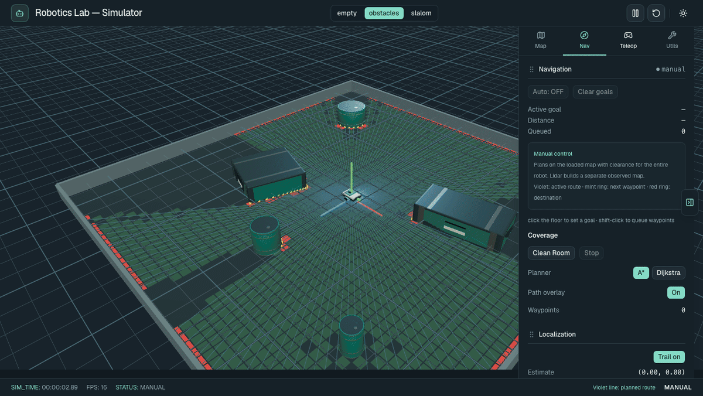

# Robotics Lab



Learn robotics by building simulations you can inspect, control and measure. Five
browser applications explore navigation, flight planning, visual SLAM, model-driven
forklift control and robot learning. TypeScript packages share geometry, sensors
and algorithms; Greenhouse adds a project-owned Python physics and training service.

See the [project philosophy and roadmap](docs/project.md). Each app has its own
implementation plan, reproducible workflows and recorded limits.

## Projects

### [Robot Simulator](apps/simulator)

A differential-drive playground for teleoperation, lidar, occupancy-grid mapping,
A* navigation, coverage and localization. Edit worlds, inspect sensor data and
replay runs through a tabbed robotics workbench. It establishes the shared
framework-independent packages used by later projects.

[Implementation plan](docs/simulator.md) · [App guide](apps/simulator/README.md)

### [Drone Mission Planner](apps/drone-mission-planner)

Compose and validate autonomous flight routes in a WebGPU scene, then execute
missions or fly manually. Virtual lidar, GPS and IMU, multiple cameras, a
Blender-authored drone and versioned mission JSON connect planning to observable
flight behavior. External flight formats and recorded replay remain future work.

[Implementation plan](docs/drone-mission-planner.md) · [App guide](apps/drone-mission-planner/README.md)

### [SLAM Studio](apps/slam-demo)

Follow a rover through an authored lab and inspect calibrated stereo images,
image-derived visual odometry, sparse mapping, bundle adjustment and geometrically
verified loop closure. Compare raw and corrected trajectories, review tracking
loss and inspect the reconstruction. Phases 1–6 are implemented; relocalization
and guided experiments remain planned.

[Implementation plan](docs/slam-demo.md) · [App guide](apps/slam-demo/README.md)

### [Warehouse Demo](apps/warehouse-demo)

An autonomous forklift unloads a seeded truck into warehouse racks. Predictable
mode runs entirely in the browser; Full Laya uses a local decision model for task
selection and vehicle control. Shared scenarios, outcome summaries and recorded
Laya playback make the controllers comparable. The scene uses Three.js WebGPU
and an authored forklift, truck and warehouse kit.

[Implementation plan](docs/warehouse-demo.md) · [App guide and preview](apps/warehouse-demo/README.md)

### [Greenhouse Caretaker](apps/greenhouse-demo)

Teach Pip to collect fallen seed capsules and deliver them to a tray. Record and
review demonstrations, train a behavior-cloned policy in PyTorch, run bounded PPO
practice and compare saved policies on the same scenario. LangGraph composes the
collection skill into multi-capsule routines and scripted docking, with persistent
traces and bounded recovery.

React Three Fiber/Drei render an original Blender greenhouse using WebGPU. A
resizable workspace combines Zustand, TanStack Query/Table/Hotkeys and
shadcn/Base UI; FastAPI streams the authoritative MuJoCo simulation from Python.
Structured observations use ideal target sensing and a constrained grasp;
expressions are authored and the robot-eye view is for inspection.

Phases 0–8 are complete. The historical frozen Phase 6 test recorded **93/100
successful deliveries, 92 clean**, for both the selected PPO actor and its BC
parent, versus **100/100 clean** for the reference. This inspected suite is not a
new Phase 8 evaluation. Fresh installation/training verification produced a new
actor with **27/30 clean validation deliveries** and a successful live seed-42
collection. These are simulated results, with remaining pickup/carrying failures.

[Release review](docs/greenhouse-demo/phase8/README.md) · [App guide and preview](apps/greenhouse-demo/README.md) · [Server guide](apps/greenhouse-server/README.md)

## Run locally

Install Node, pnpm and a current browser, then:

```sh
pnpm install --frozen-lockfile
```

| Project | Development command | Renderer / service |
| --- | --- | --- |
| Robot Simulator | `pnpm -C apps/simulator dev` | WebGL |
| Drone Mission Planner | `pnpm -C apps/drone-mission-planner dev` | WebGPU |
| SLAM Studio | `pnpm dev:slam` | WebGL2, port 8082 |
| Warehouse Demo | `pnpm -C apps/warehouse-demo dev` | WebGPU, port 8084 |
| Greenhouse Caretaker | `pnpm dev:greenhouse` | WebGPU, port 8086; Python API, port 8001 |

Warehouse Predictable mode needs no backend. Full Laya additionally needs its
local server at `http://127.0.0.1:8000/v1/systemone`. After activating the Python environment where Laya is installed, start it with `LAYA_HOST=127.0.0.1 laya-serve`.

Greenhouse requires [uv](https://docs.astral.sh/uv/) to install the locked Python
3.11 environment; dependencies stay local to the project:

```sh
pnpm setup:greenhouse
pnpm dev:greenhouse
```

Open http://127.0.0.1:8086/. The paired development command owns both services and
stops them with Ctrl-C. Reference collection and structured missions need no
provider account; optional language-to-plan drafts use server-side credentials.
A fresh checkout has no trained weights: follow the [training guide](docs/greenhouse-demo/phase8/README.md#fresh-checkout-and-training).

## Repository layout

```text
apps/
  simulator/                 differential-drive robotics workbench
  drone-mission-planner/     flight planning and simulation
  slam-demo/                 stereo visual SLAM and reconstruction
  warehouse-demo/            WebGPU forklift and decision-model comparison
  greenhouse-demo/           WebGPU teaching and robot-learning workspace
  greenhouse-server/         FastAPI, MuJoCo, PyTorch and LangGraph (uv-managed)
packages/
  core, math, geometry/      shared types and geometry
  robot, drone/              framework-independent dynamics
  maps, noise, sensors/      worlds and sensor models
  occupancy-grid, navigation/ mapping, A*, goal control and coverage
  rendering/                 reusable R3F components and browser test bridge
assets/                      editable Blender sources and export tools
docs/                        plans, reviews, metrics and captured evidence
```

Applications compose packages; packages never depend on applications. Shared
TypeScript simulation code runs without React or a browser. Greenhouse physics
is independently implemented in Python and shared by interactive execution and
headless training. The browser renders snapshots rather than running a second
physics world.

## Stack and checks

| Concern | Tools |
| --- | --- |
| Workspace | pnpm workspaces; uv for the Python project |
| Frontend | TypeScript, React, Vite, Three.js, React Three Fiber/Drei |
| Interface | Tailwind, shadcn/Base UI, Zustand; TanStack Query/Table/Hotkeys in Greenhouse |
| Learning service | FastAPI/WebSocket, MuJoCo, PyTorch, Gymnasium, LangGraph/LangChain |
| Verification | Vitest, Playwright, pytest, Biome, Ruff, mypy and generated contracts |

```sh
pnpm exec vitest run packages
pnpm -C apps/simulator test:e2e
pnpm test:e2e:soak
pnpm -C apps/drone-mission-planner test
pnpm -C apps/slam-demo test
pnpm -C apps/warehouse-demo test
pnpm test:greenhouse
pnpm test:e2e:greenhouse
pnpm build:greenhouse
```

The [browser-testing guide](docs/e2e.md) and [world-coordinate test bridge](docs/e2e-world-click.md)
explain how simulation behavior is checked through public controls. App guides
cover their own build commands and artifact requirements.

## Screenshots and animations

```sh
pnpm readme:gif             # rebuild the five-project header animation
pnpm screenshots:warehouse # running warehouse app → square images and MP4
pnpm screenshots:slam      # running SLAM app → square images
pnpm screenshots:greenhouse # running greenhouse app + trained BC/PPO models
```

The header generator builds and captures all five applications sequentially and
replaces `docs/readme-header.gif` after successful encoding. Frame ranges and
settings are recorded in [readme-header.json](docs/readme-header.json). It owns
preview servers on ports 8080, 4194, 4195, 4184 and 4196, plus an isolated
Greenhouse API on 8009, and closes them afterward. Greenhouse's header segment
uses the labeled scripted reference and needs no trained artifacts. Its eight frames also form Greenhouse’s short local README GIF.

Media capture requires local Chrome with WebGPU support and ffmpeg; the simulator
header capture also uses Playwright Chromium. Header defaults are eight frames
per project, 900 ms apart, at 1200 px width. Override `E2E_FRAME_COUNT`,
`E2E_FRAME_MS`, `WIDTH` or `FRAMERATE`; `scripts/build-readme-header.sh` accepts an
optional output path.

Greenhouse's five [1080 × 1080 screenshots](apps/greenhouse-demo/screenshots/README.md),
[preview GIF](apps/greenhouse-demo/media/preview.gif) and
[comparison MP4](apps/greenhouse-demo/media/learning-comparison.mp4) are ready for
later posts. Its video explicitly shows recorded BC/PPO/reference validation
rollouts; the live learned and mission screenshots are captured separately.

## Next possibilities

Each project keeps deferred work in its own plan. Longer-term directions include
relocalization, additional learned manipulation tasks and camera-based policies,
plus ROS2 visualization and a bridge for eventual hardware experiments. No
hardware transfer is claimed by the simulation demos.
