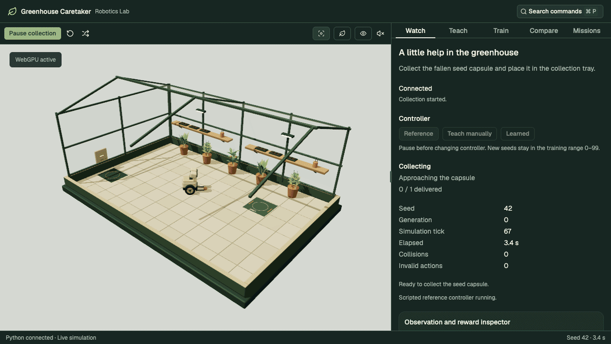

# Greenhouse Caretaker



The short GIF and [MP4 preview](media/preview.mp4) show the same 7.2-second live scripted-reference collection sequence, using the eight Greenhouse frames from the global showcase.

Greenhouse workspace for Robotics Lab's robot-learning project through Phase 8. React Three Fiber and Drei render an authored Blender greenhouse and articulated caretaker using actual Three.js WebGPU; Tailwind and shadcn/ui with Base UI provide the interface. Python runs the authoritative MuJoCo world. Reference and manual teaching controllers can produce versioned demonstrations; a separate PyTorch worker trains saved policies for live learned execution.

From the repository root:

```sh
pnpm install --frozen-lockfile
pnpm setup:greenhouse
pnpm dev:greenhouse
```

Open `http://127.0.0.1:8086/`. The paired command starts the project-owned FastAPI server on port 8001. Node/pnpm and uv are required; a supported Python interpreter and dependencies are managed locally by uv. No global Laya installation or model credentials are required.

The app connects automatically and creates a ready seed-42 world. **Start collection** runs the reference controller through approach, grasp, lift, delivery, lowering and release. **Pause collection** freezes the Python world; **Resume collection** continues the same run. **Restart seed** restores its initial state and increments the generation; **New seed** chooses a different feasible scenario. **Overview** and **Follow** select the camera. The panel shows stage, elapsed simulated time, delivery, collisions, invalid actions and recent events.

**Reconnect** releases the old session and creates a fresh one. Lost or unavailable servers display retry instructions; disconnecting pauses a running world. A missing WebGPU adapter prevents rendering while connection controls remain usable. The controller, idealized target sensing and abstract grasp are labeled explicitly.

The scene loads six local GLBs: the cutaway greenhouse, Pip caretaker, capsule and three plant variants. **Robot eye** adds inspection from the articulated head mount; it is not controller perception. Head attention/nods, blinking and status lighting are authored. System reduced-motion changes disable decorative head/blink motion and camera easing. **Sound off/on** controls local pickup/delivery cues and defaults off. Asset loading and failure are visible without disabling server reconnection controls. Blender is needed only to rebuild the assets; see the [editable kit guide](../../assets/greenhouse-demo/README.md).

## Workspace updates

The viewport stays visible beside a tabbed, resizable inspector: **Watch**, **Teach**, **Train**, **Compare**, and **Missions**. On mobile it becomes a vertical split. Use Cmd+P / Ctrl+P to search panels and actions; Cmd/Ctrl+1–5 opens the tabs. Split sizes and checkpoint selection persist locally. Watch contains controller selection; Teach contains recording and the dataset library; Train contains the shared saved-checkpoint selector.

Zustand owns workspace selections and exclusive playback; TanStack Query caches REST data while the WebSocket continues to stream live simulation state. Tables support sorting, filtering and pagination. Selects use shadcn/Base UI, and the training loss chart uses shadcn/Recharts. Watch also includes an optional observation/reward inspector. Validation replay buttons identify failed outcomes. See the [between-phase update log](../../docs/greenhouse-demo/updates/README.md) for decisions, controls and verification.

## Teach and review

Choose **Teach manually** in Watch while ready/paused, then open Teach and choose **Record demonstration** from a reset world. Hold the movement/lift buttons or focus the teaching panel and use W/S, A/D, Q/E, with G/R for close/open. Key release, focus loss and hiding the page clear input; a 250 ms server lease also prevents stale movement. The panel shows measured speed, target range/bearing, lift and holding state. Pause before switching controllers; executed reference/manual transitions are marked as interventions.

Recording captures all executed 20 Hz control steps, before/after observations, actions, physical states, events, both simulated/wall timing, configuration and task outcome. Stop/save retains partial attempts; delivery/failure saves automatically. Reset/disconnect seals the old recording. Live demonstrations start unreviewed and excluded. New random seeds stay within training seeds 0–99.

The library can prepare 20 verified expert demonstrations, load recorded-state playback, scrub frames, inspect actions/observations, save quality notes, include/exclude entries, validate compatibility/splits and export/import portable JSON. Reviews are sidecars and do not rewrite source episodes. Failed/incomplete attempts remain inspectable and cannot be marked usable. Repeating expert collection preserves existing seed episodes and review choices.

Playback uses recorded states and disables live controls; it never re-simulates or sends recorded actions to the robot. The backend separately verifies trajectories by replaying executed actions through MuJoCo. Full local artifacts live under `apps/greenhouse-server/runtime/datasets/v1/`; uploads/exports are limited to 20 MiB, individual episodes to 4 MiB/600 steps, and the store to 200 episodes/256 MiB. `GREENHOUSE_DATASET_DIR` selects another server-side directory. See the [Phase 4 review](../../docs/greenhouse-demo/phase4/README.md) for the workflow, schema, seed rules and current evidence.

## Train and run a learned skill

Prepare reviewed eligible demonstrations, then use **Train policy** in **Teach, train, then watch**. The panel shows persisted progress, fitting loss, complete validation outcomes, corrective sample counts and failures. Defaults are 120 epochs per round and three training-only correction rounds; training is cancellable without blocking the live world.

Choose a saved checkpoint, then **Use selected checkpoint** while ready/paused and **Start collection**. The learned controller and checkpoint ID remain explicit. Learned execution has no reference-controller recovery and cannot be recorded as a Phase 4 demonstration. Validation review plays recorded states independently of live simulation.

The selected local checkpoint delivers on 29/30 validation seeds, 28 clean, compared with 30/30 clean reference runs. Local weights are ignored; a fresh checkout needs data and training. See the [Phase 5 review](../../docs/greenhouse-demo/phase5/README.md) for reproducibility, normalization/loss, remaining failures and screenshots. PPO practice is now implemented in Phase 6; LangGraph missions are now implemented in Phase 7.

## Practice and compare

Select a BC checkpoint and choose **Practice selected imitation policy** for a bounded PPO run. The practice panel shows curriculum stage, steps, reward components, losses and validation selection. BC weights remain available; practice does not overwrite them. Default runs use 36,864 training steps and a 240-second budget in a separate Python process.

**Compare policies** measures two chosen checkpoints and the reference on the same validation seed, then offers recorded playback for each outcome. Seed 10000 shows delivery; seed 10006 exposes a learned pickup failure. Scrubbing and switching recordings sends no live actions. Pause the live world before comparing, then use **Return to live** to resume its controls.

The frozen final-test result is 93/100 delivered, 92 clean for both selected PPO and BC, versus 100/100 clean reference. Selected PPO reduces rejected actions from 917 to 2; completion has not improved. See the [Phase 6 review](../../docs/greenhouse-demo/phase6/README.md) for the three-seed comparison, remaining failures, final-test seal/audit and screenshots.

## Greenhouse missions

Phase 7 adds **Give Pip a greenhouse routine**: choose one to three capsules followed by docking, or dock only. Select a saved collection checkpoint, then **Start mission** from a reset ready world. The default learned seed-42 routine is verified for three deliveries and docking, with zero collisions/rejected actions. Alignment and docking are explicitly scripted; learned collection uses the selected actor without reference recovery. A small four-scenario audit completes two missions and safely stops two carrying failures, so reliable mission generalization is not claimed.

The panel shows the plan, current implementation, progress, bounded recovery reasons and a persistent graph trace. Pause/resume is explicit. Resets/reconnects invalidate old ownership; old checkpoints remain inspectable but cannot drive replacement sessions. **Inspect graph checkpoint** reads actual SQLite LangGraph state.

Structured selection works without a model provider. Optional natural-language drafting uses one LangChain tool call configured on the server, returns a typed proposal and requires explicit start. See the [Phase 7 review](../../docs/greenhouse-demo/phase7/README.md) for provider setup, physical inventory limits, skill contracts, persistence/ownership and evidence. Blender is not needed for these reused assets.

## Development and contracts

```sh
pnpm -C apps/greenhouse-demo dev
pnpm contracts:greenhouse
pnpm test:greenhouse
pnpm build:greenhouse
pnpm test:e2e:greenhouse
```

Vite proxies `/api/v1/greenhouse` to the Python service, including WebSocket upgrades. `GREENHOUSE_SERVER_ORIGIN` changes that server target. Preview uses the same proxy. A deployed static frontend would need a separately hosted Python service and reverse proxy; this phase does not publish either app.

HTTP types come directly from exported Pydantic JSON Schema. A small fetch client validates responses with Ajv. WebSocket types and validation come from separate discriminated message schemas. The frontend uses TypeScript **7.0.2**; no compiler downgrade or OpenAPI generator is needed. Generated files are committed and checked for drift, and are excluded from manual formatting/linting. Regenerate after editing Python contracts.

The connection hook owns transport state, an abortable four-second HTTP startup window, a stream watchdog, bounded pending commands, and generation/session checks. An accepted reset acknowledgment advances the generation barrier before new snapshots arrive. Old connection callbacks cannot change a new connection's state. There is no client-side simulation or silent replay fallback. The renderer interpolates only two authoritative snapshots, snaps on reset/pause/attachment transitions and never extrapolates physics. Wheel angles and lift height come from Python.

## Browser checks and captures

Playwright uses local Chrome with WebGPU support. It starts the paired development command if the app is not already running, and uses graceful shutdown to stop both services afterward. Browser checks cover the previous collection/connection/asset/camera/motion/sound cases, plus manual recording, focus/release stopping, source-preserving review, exact recorded playback, expert collection, validation and export/import, learned checkpoint delivery and active-training responsiveness/cancellation, and same-scenario BC/PPO/reference playback with no live commands, persistent three-object missions and reconnect invalidation. Checkpoint-dependent learned collection, comparison and mission cases explicitly skip when their local artifacts are unavailable. Teaching tests save automated attempts; use a separate `GREENHOUSE_DATASET_DIR` for an isolated test service when keeping them out of your normal library. The root test command also validates GLB geometry/pivots/resources and manifest alignment with compiled MuJoCo geometry.

```sh
GREENHOUSE_CAPTURE=1 pnpm test:e2e:greenhouse
```

This additionally writes current captures and portable demonstration examples to `docs/greenhouse-demo/phase5/`. `node scripts/greenhouse-phase4/review.mjs` prepares/reuses the expert set, imports the explicitly excluded automated manual example, validates the library and captures desktop/mobile review views. Prior Phase 3 asset/performance evidence remains archived. See the [Phase 4 review](../../docs/greenhouse-demo/phase4/README.md), [implementation plan](../../docs/greenhouse-demo.md) and [server guide](../greenhouse-server/README.md).

To check the production bundle, start `pnpm -C apps/greenhouse-server start` and `pnpm -C apps/greenhouse-demo preview` in separate terminals, then run `GREENHOUSE_E2E_URL=http://127.0.0.1:4186 pnpm test:e2e:greenhouse`. Setting that URL skips Playwright's automatic development-server startup.

## Release and post media

Phase 8 is complete. The [release review](../../docs/greenhouse-demo/phase8/README.md) records clean-checkout setup, a fresh training run, service/resource limits and verification. That fresh run achieved 27/30 clean validation deliveries and a successful live seed-42 collection; the historical selected BC actor's 29/30 result and frozen BC/PPO test results remain separate experiments. No new final-test performance is claimed.

Five [square screenshots for a later post](screenshots/README.md) show the workspace, live learned carrying, training, validation failure comparison and mission progress. Regenerate the screenshots using:

```sh
pnpm dev:greenhouse
# another terminal, after preparing the documented BC/PPO checkpoints:
pnpm screenshots:greenhouse
```

Regenerate the preview GIF and MP4 with `pnpm readme:gif`; both share the global showcase frames. `GREENHOUSE_URL` overrides the frontend URL. Local Chrome/WebGPU and ffmpeg are required. This captures existing policies without retraining them. The app continues to require its Python server: the checked-in GIF/video are viewable offline, but an offline application mode is not included.

For X, use the [1080 × 1080 square video](media/x-preview.mp4): a fresh seed-42 scripted-reference collection, switching from overview to follow view and ending at delivery. With the app running, regenerate it using `pnpm video:greenhouse:x`. It exports H.264 at 30 fps with fast-start playback, matching the Warehouse post format. [Capture metadata](media/x-preview.json) records the source and timing.
