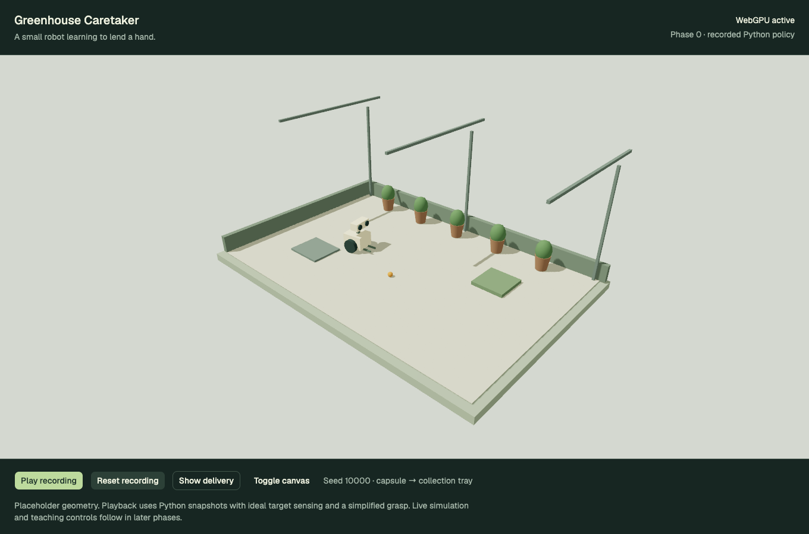

# Phase 0 review — task, simulation and learning feasibility

Phase 0 is complete. Stop for user review before Phase 1. This is an isolated feasibility probe, not the application or its FastAPI service.



## Decision

Proceed with a Python-owned MuJoCo simulation, PyTorch for imitation learning, and a browser presentation built with React Three Fiber, Drei, actual WebGPU, Tailwind CSS and shadcn/ui. Keep Python simulation and training independent of rendering and transport. Introduce the project-owned FastAPI service and root pnpm startup commands in Phase 1.

One shared goal-conditioned policy is sufficient for the first feasibility task. Its target is the capsule when empty and the tray while carrying. The holding observation supplies the task phase. All three action outputs—forward speed, yaw speed and gripper command—come from the learned network during learned runs; the expert controller does not take over.

## Task and physical assumptions

The floor is 6 × 4 m. A 2 kg wheeled robot is represented by a planar chassis with a 0.23 m collision radius and a 0.34 m gripper reach. One 5 cm-radius capsule starts in a reachable clear area. The collection tray is centered at `(1.65, 0.65)` m with a 0.20 m acceptance radius. Plants and roof supports are decorative placeholder geometry in this probe; they do not introduce obstacle-navigation claims.

Physics advances at 200 Hz, control at 20 Hz, and the exported recording at 10 Hz. Python uses Z-up coordinates; the renderer maps `(x, y, z)` to `(x, z, -y)`. Episodes finish on successful release, the first chassis/wall collision or a 30-second timeout. Reset restores the seeded initial state and clears task counters.

The nine observations contain normalized robot-relative target coordinates, bearing sine/cosine, range, body velocities and holding state. These are ideal simulator observations. No camera-derived perception, range sensor or observation noise is implemented yet.

Pickup is a checked attachment, not finger-contact simulation. An empty gripper must be within 10 cm of the capsule and receive a low commanded speed. While carried, the capsule follows the gripper tip at 28 cm height; release lowers it to the floor and checks tray acceptance. Capsule/chassis contact and carried-load forces are not modeled. Phase 2 must strengthen the speed gate to use measured motion and implement explicit gripper-height rules. Wheel rolling, slip, articulated fingers, tray-wall contacts and drop dynamics remain unproved.

See the machine-readable [task contract](contract.json) for units, actions, observations, termination, dataset splits, curriculum and proposed subsequent-phase gates.

## Learning experiment

The dataset contains 100 scripted expert episodes from seeds 0–99 plus 12,000 teacher-labeled synthetic observation states. Synthetic examples broaden the local observation coverage and can include unreachable poses; they are not presented as successful physical demonstrations. Rare grasp/release examples receive additional copies. There are 33,110 total training examples after weighting.

The policy is a small `9 → 64 → 64 → 3` tanh network trained with supervised behavior cloning on CPU. There are no user demonstrations or reinforcement-learning updates in this phase. The run used 80 epochs with validation every 10 epochs. Checkpoint selection used validation completion first, then mean episode duration; epoch 10 was selected. Lower training loss at later epochs did not produce faster task execution.

| Controller | Validation completion | Collisions | Invalid grasps | Mean simulated episode |
| --- | --- | --- | --- | --- |
| Scripted reference | 30/30 | 0 | 0 | 7.45 s |
| Untrained network | 0/30 | 10 | 0 | 29.21 s |
| Selected learned network | 30/30 | 0 | 0 | 6.55 s |

Validation seeds are 10000–10029 and are disjoint from demonstration seeds. Final test seeds 20000–20099 remain reserved and were not evaluated. The 30/30 result is checkpoint-selection evidence on a small, easy validation suite, not a final generalization claim or evidence that the policy outperforms an optimized controller. Only one training initialization was measured.

Training plus periodic validation took **5.06 s**, excluding import/startup and dataset collection. The selected network's rollouts measured about **11,735 control steps/s**, including Python observation handling, inference and ten MuJoCo substeps per control step. The reference measured about **13,471 control steps/s**. These are single-process reference measurements, not parallel-training benchmarks or an estimate for image-based learning.

The [learning report](learning-probe.json) includes per-episode outcomes, loss history, timings, versions and a dataset checksum. Model weights and the NumPy dataset are generated under the ignored `scripts/greenhouse-phase0/artifacts/` directory. The [Python snapshot recording](python-snapshots.json) is retained for browser review.

## Browser verification

The browser probe consumes the saved Python recording. It interpolates render poses, preserves discrete attachment/release transitions and resets the playback generation. It does not run an independent simulator or connect to a live Python API. Controls and state messages explicitly identify recorded playback.

The production build was checked in Chrome on macOS ARM64 with an Apple Metal 3 adapter, without a WebGPU-enabling override. React Three Fiber and Drei use their WebGPU entries, and the renderer's actual backend is checked after initialization. When WebGPU is absent, the canvas is blocked and the interface explains the requirement.

Verified behavior:

- Python-to-Three.js positions and heading match the source recording.
- Playback advances, reset discards the previous timeline, and final capsule placement matches Python.
- Drei OrbitControls change the camera view.
- The shadcn Button uses the Base UI primitive with the expected component slot and computed Tailwind background, padding and radius; keyboard activation works.
- Canvas unmount/remount returns to one active canvas.
- A 390 px viewport has no horizontal overflow.
- The production page has no browser errors. Two R3F scheduler warnings occur when invalidating an already unmounted root during the lifecycle probe; retain this as an alpha-stack limitation to inspect in Phase 1.

The initial dev check caught a final-release interpolation error: the last held position persisted at the end of playback. Discrete transitions now select the final state at their boundary, and the production check verifies exact final placement. A final physics check also caught a capsule/floor collision-mask omission; the floor now accepts both chassis and capsule contact groups, and a resting-height check prevents capsules falling through it. The foundation ends below the floor finish to avoid coplanar surfaces.

See the [browser report](browser-probe.json), [delivery view](webgpu-delivery.png) and [mobile view](webgpu-mobile.png). Frame intervals are reference measurements in that report, not a cross-device performance guarantee.

## Pinned probe stack

| Component | Version |
| --- | --- |
| Python | 3.11.15 |
| MuJoCo | 3.17.0 |
| PyTorch | 2.15.0 |
| NumPy | 2.4.6 |
| React / React DOM | 19.2.7 |
| React Three Fiber | 10.0.0-alpha.5 |
| Drei | 11.0.0-alpha.7 |
| Three.js | 0.185.1 |
| Tailwind / Tailwind Vite plugin | 4.3.2 |
| Base UI (`@base-ui/react`) | 1.9.0 |
| Vite | 8.1.2 |
| TypeScript | 7.0.2 |

The greenhouse shadcn configuration uses Base Nova. Its Button follows the official Base UI component source, preserving the greenhouse variants and semantic colors; the class-name utility is reused from `apps/simulator`. shadcn components are source files, not a separate runtime package. Python and frontend dependencies have independent lockfiles in the isolated probe. Python 3.11 was selected from an existing compatible interpreter instead of using the machine's default Python 3.15. No global Python project dependencies were added.

The frontend typecheck/build passes. Vite reports large chunks from the Three.js/Drei stack and recommends replacing the unused SWC-specific path with its standard React plugin. These are not Phase 0 blockers; dependency promotion, loading budgets and the renderer lifecycle belong in Phase 1 and the later visual/performance pass.

## Visual brief and initial assets

The viewport is the focus: a warm cutaway greenhouse, an original small caretaker and a readable capsule-to-tray task. The GUI uses the monorepo's restrained layout, with greenhouse-specific fern, leaf and seed colors. The prototype uses fern `#172622`, leaf `#bedb9d`, paper `#eef1df`, floor `#c6c6a8`, capsule amber `#d2943e` and pot clay `#9a7756`. Geist remains the interface family to connect the app to Robotics Lab. These are a feasibility palette, not a finished brand system.

The layout keeps the title/status above a large left-aligned scene and task controls below. Placeholder geometry deliberately establishes proportions before material and character detailing. The task should remain legible from overview, follow and eventually robot-eye views.

| Asset | Purpose and required structure |
| --- | --- |
| Caretaker | Original wheeled chassis, support, binocular head with pan/tilt, gripper/lift and named pivots; align final collision and reach dimensions |
| Greenhouse shell | Cutaway foundation, floor, frames and translucent glazing with unobstructed overview |
| Plants and pots | Reusable low-cost variants, clear footprints and later collision rules |
| Potting bench | A believable work area positioned outside the initial travel corridor |
| Seed capsule | Recognizable small collectible with a visible pickup location |
| Collection tray | Clearly marked destination with dimensions matching acceptance checks |
| Charging nook | A readable home location for later docking missions |

Blender is not required for Phase 0. Ask the user to open Blender and enable Blender MCP before interactive asset authoring in Phase 3, or earlier if a concrete asset inspection becomes necessary. Preserve `.blend` sources, repeatable exports and a shared dimensions/pivots manifest when authoring starts.

## Reproduce and inspect

From the repository root, with Node/pnpm and uv available:

```sh
uv sync --project scripts/greenhouse-phase0 --python 3.11 --locked
uv run --project scripts/greenhouse-phase0 python scripts/greenhouse-phase0/probe.py --epochs 80 --training-seeds 100
pnpm --dir scripts/greenhouse-phase0/web install --frozen-lockfile
pnpm --dir scripts/greenhouse-phase0/web dev
```

Open `http://127.0.0.1:8085/` for labeled recorded playback. The recorded snapshot file is committed, so browser inspection does not require retraining. The first Python setup may download a compatible interpreter and dependencies. The web probe is an isolated nested workspace; it is not yet a root application.

For production/browser checks, install the existing monorepo dependencies for the Playwright harness, build the probe and serve its preview in a separate terminal:

```sh
pnpm --dir scripts/greenhouse-phase0/web build
pnpm --dir scripts/greenhouse-phase0/web exec vite preview --host 127.0.0.1 --port 4185 --strictPort
```

Then capture and verify with local Chrome installed:

```sh
GREENHOUSE_PROBE_URL=http://127.0.0.1:4185 node scripts/greenhouse-phase0/review.mjs
pnpm exec biome check scripts/greenhouse-phase0/review.mjs scripts/greenhouse-phase0/web/src scripts/greenhouse-phase0/web/vite.config.ts
```

## Next phase boundary

Phase 1 promotes the chosen stack into `apps/greenhouse-demo` and `apps/greenhouse-server`, adds the uv-managed FastAPI service, generated contracts and root pnpm commands, and establishes live session lifecycle. The production simulation and teaching system remain later work. No root application, running FastAPI service, LangGraph workflow, RL trainer or Blender asset pipeline was created in Phase 0.
