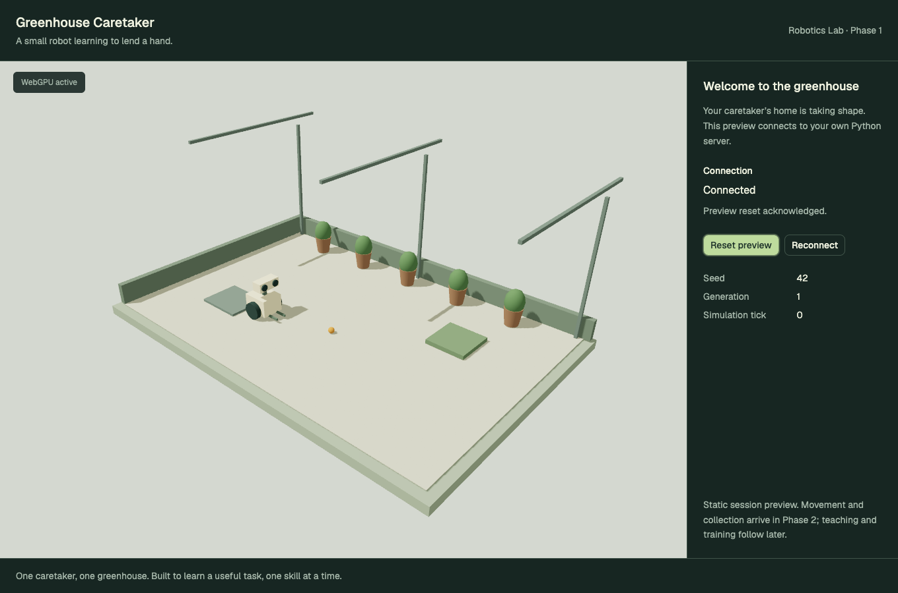
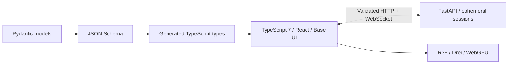

# Phase 1 review — monorepo service and application foundation

Phase 1 is complete. Stop for user review before Phase 2.



## Result

`apps/greenhouse-demo` and `apps/greenhouse-server` now belong to the pnpm workspace. A root command starts Vite and the uv-managed FastAPI service together. The browser creates a session, validates Python's initial state, connects a WebSocket and renders that state through React Three Fiber, Drei and an actual WebGPU backend. Tailwind and shadcn/ui use Base UI, with the requested TypeScript 7 compiler.

The scene is a **static foundation preview**, not live robot simulation, learned control or recorded playback. Python supplies the seeded layout and authoritative session generation; simulation tick remains zero. Movement, grasp rules, the reference controller and physics remain Phase 2. No MuJoCo, PyTorch, Laya, LangGraph or model-provider credentials are needed to start this phase.

## Start and review

From the repository root, with Node/pnpm and uv installed:

```sh
pnpm install --frozen-lockfile
pnpm setup:greenhouse
pnpm dev:greenhouse
```

Open `http://127.0.0.1:8086/`. The Python API is at `http://127.0.0.1:8001`; FastAPI's inspection docs are at `/docs`. The setup uses Python 3.11.15 from `.python-version` and installs locked dependencies into the server's `.venv`. Ctrl-C stops both applications, including the Python reload process.

The page connects automatically to a seed-42 preview. **Reset preview** sends a command, shows its acknowledgment and updates the generation. **Reconnect** discards the current connection and creates a new session. Missing-server and connection-closed states explain how to retry. If WebGPU is unavailable, the renderer stays disabled while connection controls continue to work.

The [frontend guide](../../../apps/greenhouse-demo/README.md) and [server guide](../../../apps/greenhouse-server/README.md) contain the setup, configuration, endpoints, contract-generation commands and limits. Screenshots also cover [mobile](mobile.png), [server unavailable](server-unavailable.png) and [WebGPU unavailable](webgpu-unavailable.png).

## Architecture and contract decision



The frontend uses a small typed fetch client, not an OpenAPI client library. HTTP model types are generated directly from Pydantic JSON Schema and responses are validated with Ajv. WebSocket messages have separate Pydantic unions, exported JSON Schemas, generated types and runtime validation. FastAPI retains its automatic OpenAPI documentation for server inspection; the frontend does not depend on it or on a TypeScript compiler-API generator. TypeScript remains **7.0.2**.

`pnpm contracts:greenhouse` exports schemas and regenerates TypeScript; `pnpm check:contracts:greenhouse` verifies source/generated consistency without rewriting files. Named `{x,y,z}` coordinate objects make the wire format explicit. Python Z-up positions map to Three.js `(x,z,-y)`.

The stream sends hello and an initial snapshot, then reset acknowledgments/snapshots and 1 Hz heartbeats. Every command identifies its request, session and expected generation; server messages also contain a tick. Stale generations, mismatched sessions, invalid messages and overly frequent accepted commands are rejected. A bounded acknowledgment cache makes retries idempotent. The browser ignores old sessions/generations/ticks and aborts requests during reconnect or disposal.

Sessions are local and ephemeral, with one stream per session, a 16-session limit and 120-second idle expiry. Server reload loses session state and the browser offers a fresh connection. Persistent experiments, training jobs and mission state are later phases.

## Verification

| Check | Result |
| --- | --- |
| Documented setup command | Locked Python environment prepared; schemas/types regenerated |
| Python API/session tests | 12 passed |
| TypeScript runtime-protocol tests | 3 passed |
| Schema/type drift checks | Passed |
| Python Ruff and mypy | Passed |
| Frontend TypeScript 7 and Biome | Passed |
| Python packaging | Source archive and wheel built |
| Frontend production build | Passed |
| Production browser suite | 6 passed against Vite preview + the Python service |
| Shared-package regression suite | 214 tests passed across 31 files |
| Development lifecycle | Occupied port rejected before frontend startup; two startup/Ctrl-C cycles released both ports |

The browser suite exercises keyboard reset/acknowledgment, loading while HTTP is pending, incompatible HTTP data, unavailable-server retry, service-side session closure with a fresh reconnect, and a missing WebGPU adapter. The production scene reported an active WebGPU backend and no page errors in the connected case. The checks use local Chrome without a WebGPU-enabling override.

The [lifecycle report](lifecycle.json) records process/port checks. Initial browser testing exposed a cleanup mismatch: Playwright force-kills its web server by default, bypassing the paired runner's signal handler. The test config now requests graceful SIGTERM shutdown before any forced fallback; the ordinary paired runner also handles Ctrl-C, port conflicts and unexpected child exit. Browser checks and subsequent lifecycle checks verify that the ports can be reused.

Existing applications' dependency versions were preserved when adding the new workspace entries. The old feasibility probe and its artifacts remain available as Phase 0 evidence; the application does not import that probe as a simulator or playback fallback.

## Limits and next phase

This phase uses placeholder geometry and a seeded static preview. It does not prove production task physics, learned behavior, camera perception or sim-to-real transfer. The service has an in-memory, single-process session registry and is a local development foundation. A hosted deployment would need a Python host and an HTTP/WebSocket reverse proxy.

The verified R3F 10 / Drei 11 versions remain pinned prereleases. Vite reports large Three.js/Drei chunks and recommends the standard React plugin when no SWC plugins are used. Python's TestClient emits a Starlette/httpx deprecation warning; the assertions pass. These are recorded toolchain limits, not simulation results.

Phase 2 will add the authoritative fixed-step Python world, capsule interactions, a scripted reference controller and start/pause/reset controls. Blender is not needed for the current foundation; ask the user to open Blender and enable Blender MCP before interactive asset work becomes necessary.
