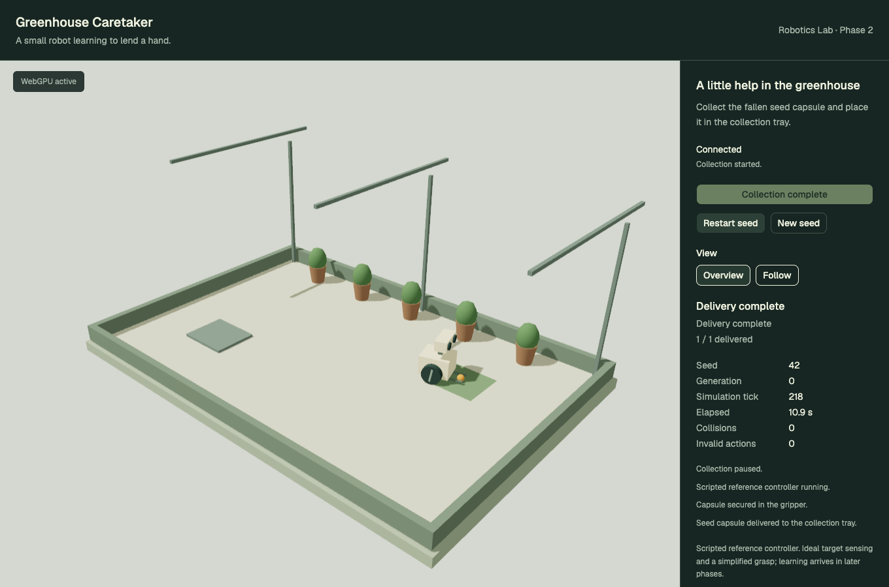

# Phase 2 review — authoritative greenhouse world and reference behavior

Phase 2 is complete. Stop for user review before Phase 3.



## What works

The caretaker now collects a seed capsule, lifts it, carries it to the collection tray, lowers it and releases it. Python owns the world, physical contacts, gripper rules and outcome. The browser displays live state with animated wheels/lift and overview/follow cameras. The controller is explicitly labeled **scripted reference**; this phase does not train or deploy a learned policy.

The headless benchmark completed **130/130 episodes**, with zero collisions and invalid actions. It covers seeds 0–99 and 10000–10029, leaving final test seeds 20000–20099 untouched. The production browser also completed a live seed-42 delivery with pause/resume and camera changes.

## Run and inspect

From the repository root:

```sh
pnpm install --frozen-lockfile
pnpm setup:greenhouse
pnpm dev:greenhouse
```

Open `http://127.0.0.1:8086/` and choose **Start collection**. Use **Pause collection** / **Resume collection** to freeze and continue the same Python world. **Restart seed** restores its initial state; **New seed** creates a different feasible starting layout. Both reset commands increment the session generation and leave the world ready. **Overview** allows orbit inspection; **Follow** tracks the caretaker.

The panel shows the controller stage, delivery count, simulated time, tick, collisions, invalid actions and recent events. Disconnecting the viewer pauses a running world. Reconnect creates a fresh session. The scene still uses placeholder assets; no Blender session was needed.

## Independent simulation

`apps/greenhouse-server/src/greenhouse/simulation` contains the MuJoCo model, `World`, `Reference` controller and benchmark. It imports no FastAPI, Pydantic, React or training framework. Each world owns independent `MjData`; a cached immutable `MjModel` is shared. The API only adapts domain state to wire models and schedules interactive stepping.

The environment exposes seeded reset, declared observations, an action step, reward/termination and immutable state snapshots. Headless callers invoke these directly without an HTTP server or browser. Later Gymnasium/training work can wrap this environment. Phase 0 policy weights are not promoted into this different environment or presented as compatible.

| Parameter | Implemented value |
| --- | --- |
| Floor | 6 × 4 m, Python X/Y plane with Z up |
| Robot body | 0.42 × 0.36 × 0.28 m chassis; 2 kg combined body/wheels |
| Wheels | 0.14 m radius; centers at lateral ±0.22 m |
| Capsule | 0.05 m radius, 0.04 kg |
| Gripper | 0.34 m forward reach; lift height 0.05–0.28 m; lift speed 0.18 m/s |
| Tray | Floor-level destination centered at `(1.65, 0.65)` m; 0.20 m acceptance radius |
| Physics / control | 200 Hz / 20 Hz; ten fixed 5 ms substeps per action |
| Streaming | Latest-state snapshots at up to 10 Hz; idle heartbeat at 1 Hz |
| Timeout | 600 control ticks / 30 simulated seconds |

MuJoCo models planar body motion, capsule gravity/floor contact and wall/pot contacts. Drive actions specify forward velocity and yaw targets through bounded planar servo actuators. The base is supported by its planar joints; wheels do not model rolling traction, slip or realistic motor torque. Their rendered angles integrate measured body motion. This intentionally keeps locomotion simpler than a hardware model.

The four boundary walls and five pot collision shapes match the browser's dimensions/positions. Roof frames, foliage and the charging marker are decorative at this stage. The tray is a floor-level collection region, rendered as a thin surface rather than a raised box whose walls would need manipulation physics.

Scenario generation confines the initial robot and capsule to a clear central corridor. Robot X is in `[-1.6,-0.8]`, capsule X in `[-0.1,0.65]`, and both Y coordinates in `[-0.7,0.7]`. Initial heading varies in `[-1,1]` radians. This yields reachable capsule/tray paths separated from the pots and boundaries. A 1,000-seed generation check verifies those placement rules; it is separate from the 130 full-rollout benchmark.

## Interaction rules and assumptions

Pickup is an abstract constrained attachment, not a simulated finger grasp. The robot must have measured planar speed ≤0.035 m/s and measured yaw speed ≤0.12 rad/s. Its tip must be within 0.085 m of the capsule, target bearing within 0.18 rad, and lift/capsule height difference within 0.025 m. Invalid requests are rejected and counted, with a visible reason.

While held, the capsule follows the gripper tip and actual lift height; carried-load forces and finger contacts are not modeled. Release requires the same measured-speed limits and lift height no higher than 0.065 m. A valid low release inside the tray's radius completes the task. An outside-tray release leaves the task unfinished. Contacts with boundaries or pots stop the run with a failure; timeout is reported separately as truncation. Pause and terminal states do not step physics.

Policy input is deliberately separated from simulator truth. `Observation` contains exact robot-relative target forward/left offsets, distance, bearing, measured forward/yaw speed, lift height and holding state. The target is the capsule while empty and the tray while carrying. These are ideal simulator observations, not camera perception. The reference controller reads only that declared observation and its own stage. Full scene truth is used for rendering, invariant checks and evaluation.

The step result provides a small provisional reward: distance progress while pursuing the same target, a time cost, valid pickup/delivery bonuses and a collision penalty. The scripted controller does not optimize this reward. Reward design and RL experiments remain Phase 6; this is not evidence of learning or reward robustness.

## Live session and rendering behavior

The lifespan clock advances connected running worlds at fixed 50 ms control intervals. Under load, simulated time can fall behind wall time; it does not skip physics steps or build an unbounded catch-up batch. The publisher serializes sends, throttles snapshots to at most 10 Hz and reads latest state rather than retaining a frame queue. A two-second send timeout closes a slow stream and pauses its world.

Commands are `start`, `pause`, `reset`, `new_seed` and `ping`. Their existing session IDs, request IDs and generation checks remain in force. Start only accepts ready/paused worlds; completed/failed worlds require a reset. Reset clears world state, controller stage, metrics, events and tick. A stale-generation command cannot start the reset world. Request retries are idempotent and accepted command frequency remains bounded.

The TypeScript 7 frontend continues using Pydantic JSON Schema for generated HTTP/WebSocket model types and runtime validation. An accepted acknowledgment advances its generation barrier before new snapshots arrive. The renderer interpolates at most two authoritative snapshots, with no extrapolation, and snaps on reset, pause, completion and attachment changes. It animates actual wheel angles, gripper state and lift height. Follow-camera smoothing respects reduced motion at initialization.

## Measured results

| Reference metric | Result |
| --- | --- |
| Completed episodes | 130/130 |
| Collisions / invalid actions | 0 / 0 |
| Simulated task duration, min / mean / max | 9.05 / 10.59 / 12.00 s |
| Seed 42 | 218 ticks / 10.90 s |
| Benchmark wall time | 4.62 s |
| Control stepping throughput | About 5,960 steps/s |

These are single-process measurements on the recorded macOS ARM64 reference setup, including observation/controller work and the seed-42 trace export. They are not GPU training benchmarks or a cross-device guarantee. MuJoCo is pinned to 3.17.0, NumPy to 2.4.6 and Python to 3.11.15. Exact same-seed/action replay is checked on this setup; arbitrary platform/version determinism is not assumed.

The [reference benchmark](reference-benchmark.json) includes per-seed results and platform versions. The [reference trace](reference-trace.json) records seed-42 observations, executed actions, rewards and resulting domain states, providing evidence for later demonstration work. It is not yet the user-facing dataset/teaching system planned in Phase 4.

The [live browser report](browser-collection.json) records the source URL, actual initial/final server snapshots, pause and follow checks, and page errors. The run completed with 1/1 delivered, no collisions or invalid actions, and no page errors. See [carrying in follow view](carrying-follow.png), [overview](connected.png), [mobile](mobile.png), [server unavailable](server-unavailable.png) and [WebGPU unavailable](webgpu-unavailable.png).

## Verification and reproduction

| Check | Result |
| --- | --- |
| Python world and API tests | 43 passed |
| TypeScript protocol tests | 3 passed |
| Browser suite, development and production | 8 passed in each run |
| Same-seed physics replay / independent worlds | Passed |
| Measured-speed and height gates | Passed |
| Floor, boundary and pot contacts | Passed |
| Pause/terminal freeze and timeout | Passed |
| Active-run reset and stale-command rejection | Passed |
| Stream rate, new seed and disconnect pause | Passed |
| Contract drift, Python lint/types, TS7 and Biome | Passed |
| Python package and frontend builds | Passed |

```sh
pnpm test:greenhouse
pnpm build:greenhouse
pnpm benchmark:greenhouse
GREENHOUSE_CAPTURE=1 pnpm test:e2e:greenhouse
```

The production check uses a Python service at port 8001 and Vite preview at port 4186, then `GREENHOUSE_E2E_URL=http://127.0.0.1:4186 GREENHOUSE_CAPTURE=1 pnpm test:e2e:greenhouse`. It verifies the actual WebGPU backend with local Chrome and no WebGPU-enabling override. Existing app dependency versions were preserved, and Phase 0/1 screenshots remain historical evidence.

The existing large-chunk build warning, prerelease R3F/Drei versions and TestClient/httpx deprecation remain documented toolchain limits. No training or LangGraph runtime is introduced in this phase.

## Next phase

Phase 3 authors the greenhouse and original caretaker in Blender, with named pivots, a dimensions/collision manifest and repeatable GLB exports. Ask the user to open Blender and enable Blender MCP before interactive asset work. Do not begin that phase until this review is accepted.
