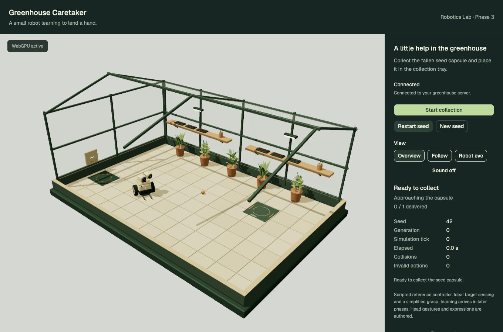
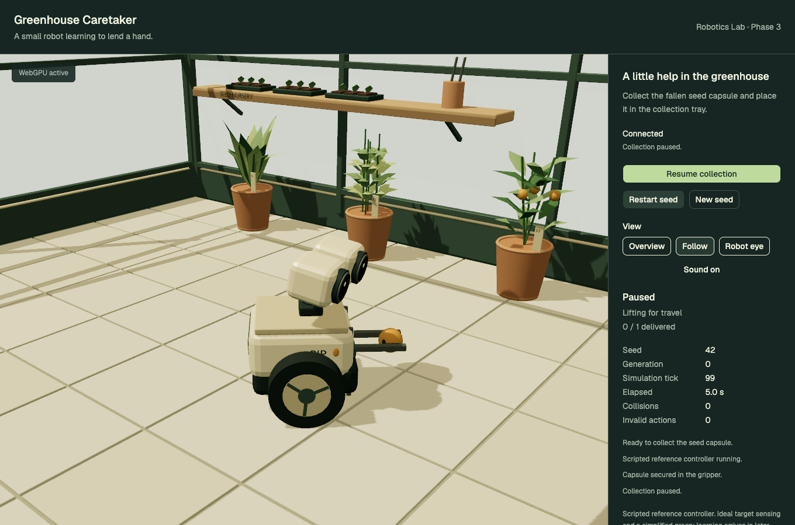
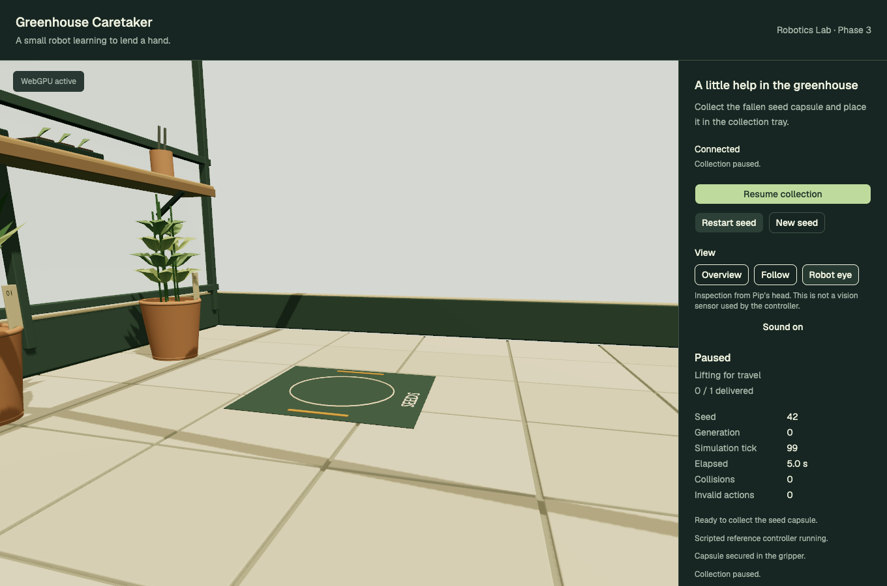
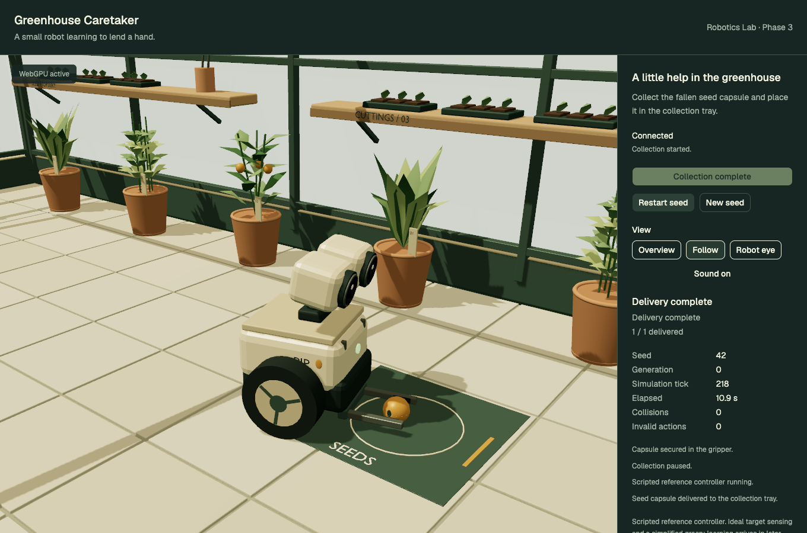

# Phase 3 review — authored greenhouse and Pip

Phase 3 is complete. Stop here for user review before Phase 4. The robot still runs the scripted reference controller; training and demonstrations have not started.

The greenhouse now uses six Blender-authored GLBs: a cutaway glazed frame, limestone pavers, floating potting benches with seedlings/tools, a floor-level collection mat, a charging nook, three potted plant variants, an articulated ivory caretaker and a seed capsule. The [visual brief](design.md), [editable source and rebuild guide](../../../assets/greenhouse-demo/README.md), [manifest](../../../assets/greenhouse-demo/manifest.json) and [export report](asset-export.json) are committed with the assets. Blender MCP connectivity was verified on port 9876 before authoring. [Source inspection](blender-source.json) confirms only the generated scene is saved, while the original active scene and its Cube/Camera/Light remain intact.



Wheel angles, base heading/position, lift height, jaw attachment state and capsule position follow Python snapshots. The browser interpolates between snapshots without running physics. Head attention, pickup/delivery nods, blinking and the status lamp are authored presentation. Changing the system reduced-motion preference immediately disables decorative head/blink motion and camera easing; actual robot motion remains visible. Sound defaults off; the explicit sound control enables short local synthesized pickup/delivery cues. The browser review observes five oscillator notes across these two real task events.



Overview retains orbit controls. Follow gives a closer view of Pip's task. Robot eye follows the actual head mount with a short near clip and a wider field of view; its label identifies inspection rather than controller perception. The scripted controller still consumes idealized structured observations.





## Verification and measurements

Verified against the production Vite preview and the live Python service. See [browser review](browser-review.json), [live collection trace](browser-collection.json) and [asset validation](asset-validation.json).

| Check | Result |
| --- | --- |
| Python tests | 44 passed, including compiled MuJoCo/manifest alignment |
| TypeScript unit tests | 3 passed |
| Production browser tests | 10 passed |
| Contracts, Python/TS type checks, Ruff and Biome | Passed |
| Python package and frontend production build | Passed |
| Runtime asset files | 6 GLBs, 3,830,988 bytes total |
| Unique exported geometry | 59,368 triangles, below 120,000 budget |
| Reference renderer | Chrome 156, actual WebGPU, Apple Metal 3 |
| Reference viewport | 1360 × 900, device pixel ratio 1, local preview |
| Cold page-to-ready load | 954 ms locally |
| Steady overview p95 frame interval | Approximately 16.8 ms; budget 33.4 ms |
| Draw calls, including shadow work | 185; budget 200 |
| Rendered triangles, including repeats/shadows | 126,021; distinct from unique asset geometry |
| GPU allocations over five resets | Stable at 79 geometries and 5 textures |
| Live reference delivery | 1/1 delivered, zero collisions and invalid actions |
| Browser console/page errors during review | None |

The review measures 180 steady frames after loading/warmup. Frame intervals include browser scheduling; they are not GPU execution timings or a guarantee for other devices. Memory counters are renderer-reported allocations, not whole-browser RAM. Loading is from a local server with a fresh browser profile, not a throttled deployment network. Vite still reports large Three.js/WebGPU chunks; code splitting is a later optimization, not hidden by changing the warning threshold. Python checks retain the existing upstream Starlette/httpx deprecation warning.

Asset and source checks cover embedded buffers, required pivots, world axes, wheel mounts and bounds, pot bounds, centered capsule dimensions and exclusion of unrelated Blender objects. Wheel hubs and sill trim were separated from adjoining surfaces after screenshot inspection exposed coplanar flicker. Cache-owned geometry/static materials survive resets; the per-character lamp material and audio context have explicit cleanup. Reset measurements show no accumulating geometry or textures. Asset loading/failure, WebGPU absence, reduced-motion changes, sound toggling and server reconnection are exercised in the browser suite.

The physics scope is unchanged: planar supported base, derived wheel angles and constrained pickup rather than simulated fingers/traction. Decorative plant foliage/head have no new collision model. Floating benches clear the complete visual robot height; destination/charging pads are nearly flat. Charging behavior, visual perception and learned policies remain later phases.

## Reproduce and review

```sh
pnpm test:greenhouse
node scripts/greenhouse-assets/validate.mjs
pnpm build:greenhouse
pnpm dev:greenhouse
```

Open `http://127.0.0.1:8086/`, start collection, try all three views, pause while carrying, enable sound if wanted, and restart/change the seed. Blender is needed only for authoring/rebuilding.

To reproduce production evidence, keep Python running, start `pnpm -C apps/greenhouse-demo preview`, then:

```sh
GREENHOUSE_E2E_URL=http://127.0.0.1:4186 GREENHOUSE_CAPTURE=1 pnpm test:e2e:greenhouse
GREENHOUSE_REVIEW_URL=http://127.0.0.1:4186 node scripts/greenhouse-assets/review.mjs
```

Additional captures: [mobile layout](mobile.png), [delivery overview](delivery-overview.png), [connected](connected.png), [server unavailable](server-unavailable.png), [WebGPU unavailable](webgpu-unavailable.png).
