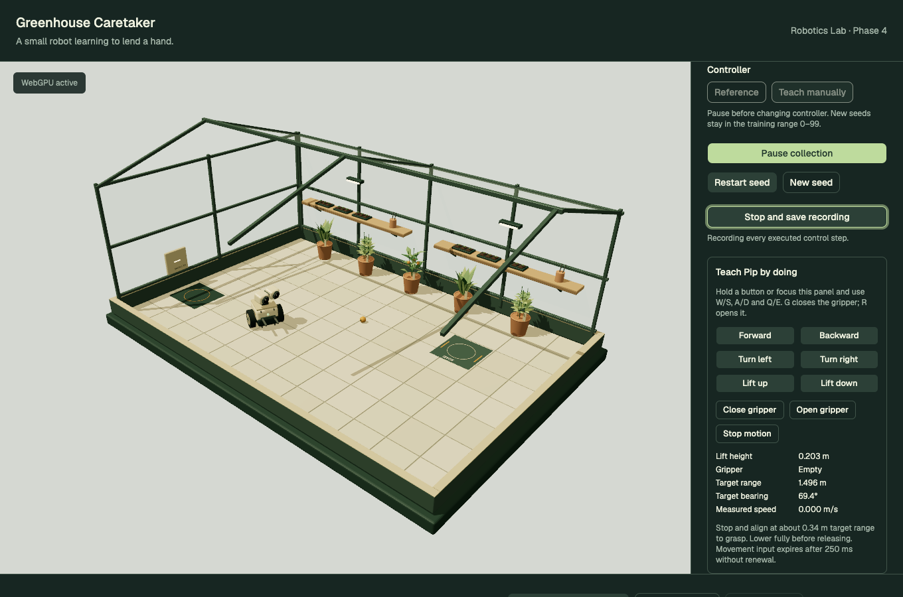
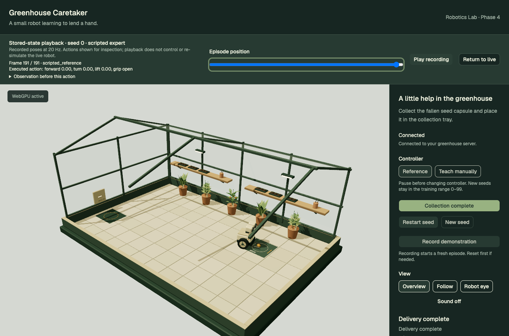
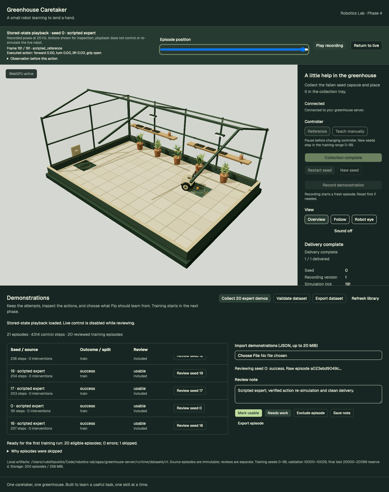

# Phase 4 review — teaching and demonstrations

Phase 4 is complete. Stop for user review before Phase 5. This phase records and curates demonstrations; it does not train or execute a learned policy.

The local library now contains **20 verified scripted expert episodes** on training seeds 0–19, with **4,269 control steps**, plus one **45-step automated manual-input example** retained and excluded from training. The latter exercises the actual browser keyboard controls and recording path; it is explicitly labeled as automation in its review note and is not presented as a human-collected demonstration. Your own demonstrations can now be recorded through the same interface.

See [dataset summary and validation](dataset-review.json), [manual/playback verification](manual-playback-check.json), and portable examples for a [scripted expert](expert-example-v1.json) and an [excluded manual attempt](manual-example-v1.json). The full local dataset stays under the ignored `apps/greenhouse-server/runtime/datasets/v1/` directory. The examples are small documentation fixtures, not a replacement for the local dataset.



## Try teaching Pip

Start with `pnpm dev:greenhouse` and open `http://127.0.0.1:8086/`.

1. Choose **Teach manually** while ready or paused. **Restart seed** restores the same initial state; **New seed** chooses another training seed from 0–99.
2. Click **Record demonstration** from a fresh ready world. This starts the robot and recording together. **Start collection** alone runs without recording.
3. Hold the on-screen movement/lift buttons, or focus the teaching panel and use **W/S** for forward/backward, **A/D** for turning, and **Q/E** for lift up/down. **G** closes the gripper; **R** opens it. The panel shows lift, holding state, target range/bearing and measured speed.
4. Stop and align near 0.34 m target range with the lift fully lowered before grasping. Lift for travel; stop and lower before releasing into the tray. The simulation checks actual speed, alignment and height and explains invalid attempts.
5. Pause to inspect or change controller. Executed manual/reference transitions are marked as interventions; a run using both sources is labeled **mixed**. No hidden expert correction runs in manual mode.
6. Click **Stop and save recording** to retain a partial attempt. Delivery, collision or timeout saves automatically. Reset or disconnection seals the attempt rather than mixing generations. Live recordings initially remain unreviewed and excluded.

Movement renews at 10 Hz while a control is held. Releasing controls, moving focus away, hiding the page or losing browser focus clears input; the server also expires input after 250 ms without renewal. Grasp/open requests are consumed once. Pausing/resetting/controller changes clear held controls. Acknowledgments for continuous input do not wait for the 10 Hz snapshot publication gate. State-command buttons respect the server's separate command interval.

If storage fails, the recording remains in its session with a visible error, the world pauses, and reset is rejected until the recording can be saved. Resolve the artifact-directory problem and retry **Stop and save recording**. An unsaved recording cannot survive process termination; successful saved episodes do survive server restarts. Recording with no executed steps produces an explicit message instead of an invalid empty episode.

## Review what happened

**Collect 20 expert demos** prepares training seeds 0–19 headlessly using the same environment and scripted reference controller. Repeating it preserves existing episodes and their review decisions. The API also accepts an explicit unique subset of seeds 0–99. Batch expert episodes are automatically marked usable only after clean completion and action re-simulation checks.

Pause collection and finish any active recording before loading a demonstration. The playback banner shows its seed/source, frame, executed action and intervention marker. Expand **Observation before this action** to inspect target offsets, measured speed, lift/holding inputs, reward and termination flags. Play/pause or scrub the timeline; all three camera modes remain available. Live commands are disabled while reviewing, and **Return to live** restores the paused/ready session.



This is **stored-state playback at simulated control timing**, not re-simulation or a video. The browser displays the recorded initial/post-action/final states; it never sends the recorded actions to the live robot. Pauses in wall time are preserved in the data but are not waited out during playback. Decorative head expressions and lighting are authored presentation, so this is not a pixel-exact replay of the original browser frames. Separate server-side validation re-simulates the executed actions and compares physical states, observations, rewards and terminal flags.

**Mark usable**, **Needs work**, inclusion/exclusion and notes update a separate review sidecar. The immutable source episode and its checksum remain unchanged. Failed/incomplete episodes cannot be marked usable; including one does not make it eligible for training. They remain available for review and export. Excluded or unreviewed demonstrations stay out of the training-ready selection.



## Episode format and local artifacts

`schema_version: 1` episodes contain:

- Identity, creation time, seed, split, source, outcome and end reason.
- Simulator version, exact MuJoCo version, source/configuration fingerprint, action/observation versions, physics/control timesteps, task dimensions and limits.
- Initial state, every executed control step and final state.
- Each step's observation, bounded executed action, next observation, post-action state, task events, controller/source, intervention marker, reward and terminal/truncation flags.
- Simulated time and monotonic elapsed wall time, including gaps caused by pausing. Headless expert collection is faster than real time; wall time is not mislabeled as simulated duration.

The fingerprint covers the model, world and reference-controller implementation. Compatibility is deliberately conservative: older feasibility recordings and different simulator builds are not silently converted. Numerical re-simulation comparisons use a `1e-7` tolerance; this is not a claim of universal bitwise portability across platforms.

Raw files are `<episode_id>.json`; reviews are `<episode_id>.review.json`. Episode IDs are opaque 32-character hex identifiers. Portable bundles contain versioned episodes, reviews and SHA-256 hashes of each canonical Pydantic episode serialization. The bundle itself is not the hashed source object, so review changes do not alter episode identity.

Default location: `apps/greenhouse-server/runtime/datasets/v1/` when launched with the documented pnpm command. `GREENHOUSE_DATASET_DIR` can select another local artifact directory. The GUI displays the resolved location. The server uses atomic file replacement for reviews and new artifacts, rejects conflicting existing IDs, preserves existing review decisions on duplicate imports, and validates a whole import before writing any episodes. One API worker owns sessions and dataset operations; do not run another writer/collector process against the same artifact directory concurrently.

| Limit | Value |
| --- | --- |
| Recording length | 600 control steps / 30 simulated seconds |
| Episode size | 4 MiB |
| Import/export | JSON only, up to 20 MiB and 100 episodes per bundle |
| Local store | 200 episodes / 256 MiB |
| Review note | 500 characters |

**Export dataset** downloads a portable bundle; **Export episode** exports the selected entry. Large stores can be exported in smaller groups through repeated `ids` query parameters. Imports enforce the byte limit while reading the request stream, then validate schema, hashes, source/completion claims, timing and deterministic action/state correspondence. No existing source file or review is silently replaced by an import.

## Split and quality gates

The declared seed splits remain unchanged:

| Seeds | Membership and treatment |
| --- | --- |
| 0–99 | Training; clean, reviewed, included successes can become training examples |
| 10000–10029 | Validation; never included in training-ready IDs |
| 20000–20099 | Reserved final test; demonstration recording/import is rejected |
| Other seeds | Unassigned/quarantined; retained for inspection, never treated as training |

**Validate dataset** checks every episode against the current configuration, seeded initial conditions, contiguous control steps, actual observations, executed actions, stored physical states, rewards, completion and truncation flags, source/intervention claims and seed membership. Claimed expert actions must match the reference controller. Only training episodes with a clean successful delivery, usable label and inclusion flag appear in `eligible_train_ids`. A validation result with errors is not ready for training; skipped episodes include explicit reasons. Final test scenarios were not evaluated in this phase.

## Verification

| Check | Result |
| --- | --- |
| Python suite | 68 passed; 24 dataset/teaching checks added |
| TypeScript unit tests | 3 passed |
| Production Chrome browser suite | 12 passed |
| Contracts, Ruff, Biome, Python/TS type checks | Passed |
| Python package and frontend production build | Passed |
| Local dataset | 21 episodes, 4,314 control steps; 20 eligible training episodes |
| Browser review | No page/console errors; mobile has no horizontal page overflow |
| Source preservation | Review changes retain identical episode body and checksum |
| Playback correspondence | Exact recorded final robot/capsule/lift pose; live tick frozen; no playback control commands |
| Manual input | Keyboard lift/motion, key release, focus loss, neutral stop, expired input and stale-generation rejection verified |
| Dataset failures | Forged source/actions/states/observations/outcomes/splits/timing/events, invalid hashes, conflicting imports, oversized uploads and storage failure tested |

Tests run against an isolated artifact directory and production preview on ports 8002/4187. The normal user library on 8001/8086 was then prepared and reviewed separately. A transient development optimizer cache error after adding UI components was resolved by reloading; the final normal-server review has no console errors. Existing Vite large-chunk and upstream Starlette/httpx deprecation warnings remain.

```sh
pnpm test:greenhouse
pnpm build:greenhouse
pnpm test:e2e:greenhouse
```

`GREENHOUSE_CAPTURE=1` adds browser evidence under this directory. `node scripts/greenhouse-phase4/review.mjs` prepares/reuses the expert seed set, imports the explicitly excluded manual documentation fixture, validates the library, and captures desktop/mobile review views. It writes the [dataset review](dataset-review.json). To target another running frontend, set `GREENHOUSE_REVIEW_URL`; its backend must allow that frontend origin. Keep test collection in a separate `GREENHOUSE_DATASET_DIR` if you do not want automated manual attempts in your normal library.

Additional views: [ready to teach](ready-to-teach.png), [manual stored-state playback](recorded-state-playback.png), [mobile teaching](mobile-teaching.png), [reference delivery](delivery-complete.png).
