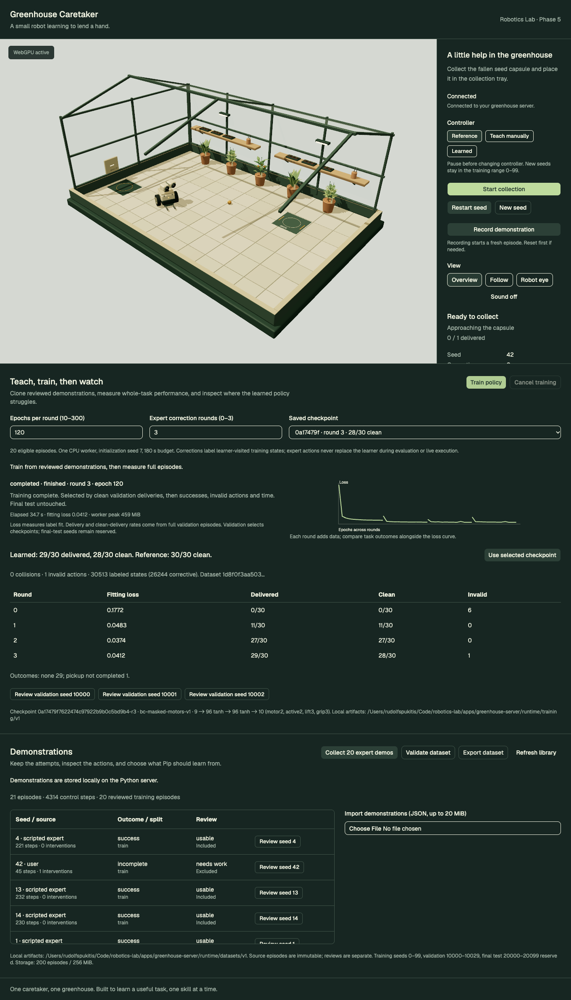
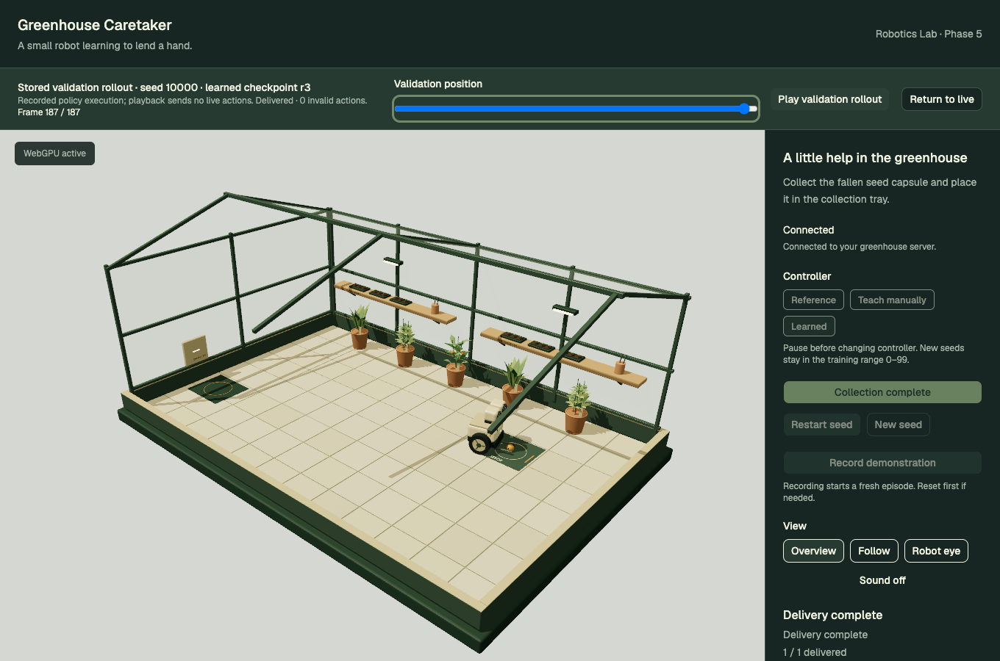
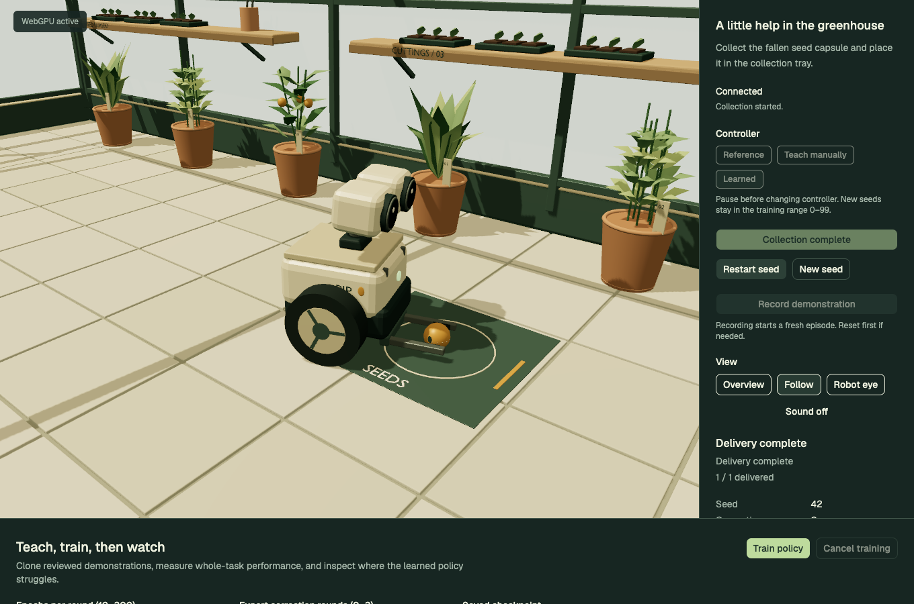

# Phase 5 — First learned collection skill

Phase 5 is complete. Pip can run a saved PyTorch behavior-cloned policy in the live simulator. Training uses a separate CPU process, and the browser supports progress, cancellation, explicit checkpoint selection and recorded validation playback. Stop here for user review before Phase 6.

## Try it

```sh
pnpm setup:greenhouse
pnpm dev:greenhouse
```

Open http://127.0.0.1:8086/. The current local checkpoint is `0a17479f7622474c97922b9b0c5bd9b4-r3`.

1. Under **Teach, train, then watch**, inspect the saved checkpoint, loss curve, round comparison and failure counts.
2. Choose **Review validation seed 10000**, play or scrub the stored states, then return to the live simulation. Playback is labeled and sends no recorded actions to a live world.
3. While ready or paused, choose **Use selected checkpoint** (or **Learned**), then **Start collection**. The live controller and checkpoint ID stay visible. Pause/resume and seeded resets work with learned execution.
4. To train again, prepare/review demonstrations in the library, then choose **Train policy**. Defaults are 120 epochs per round, three correction rounds, initialization seed 7 and a 180-second worker budget. **Cancel training** persists a cancelled job and leaves fully evaluated earlier checkpoints available.

Model weights and full training artifacts are local, ignored runtime files. A fresh checkout needs eligible demonstrations and a training run before learned execution is available. The CLI helper uses the running local API and the same real worker:

```sh
node scripts/greenhouse-phase5/train.mjs
node scripts/greenhouse-phase5/review.mjs
```

The training helper writes new experiment summaries here; the review helper reuses a completed checkpoint and captures desktop/mobile playback and live execution. Neither Blender nor a GPU nor model-provider credentials are required. Node runs the frontend/tooling; Python remains the only application server.

## Measured result

This actual worker run used 20 clean, reviewed scripted expert episodes, seeds 0–19, containing 4,269 control steps. The excluded automated manual-input example was not training data; no human demonstrations are claimed. Every round was evaluated for complete pickup/delivery episodes on all 30 validation seeds, 10000–10029, with the original 600-step/30-second limit.

| Controller / round | Training states | New corrective labels | Final fitting loss | Delivered | Clean deliveries | Collisions | Invalid actions |
| --- | ---: | ---: | ---: | ---: | ---: | ---: | ---: |
| Scripted reference | — | — | — | 30/30 | 30/30 | 0 | 0 |
| BC round 0 | 4,269 | 0 | 0.17720 | 0/30 | 0/30 | 0 | 6 |
| BC round 1 | 16,269 | 12,000 | 0.04829 | 11/30 | 11/30 | 0 | 0 |
| BC round 2 | 26,222 | 9,953 | 0.03739 | 27/30 | 27/30 | 0 | 0 |
| BC round 3, selected | 30,513 | 4,291 | 0.04124 | 29/30 | 28/30 | 0 | 1 |

A clean delivery requires success with zero collisions and zero invalid actions. Selection prioritizes clean deliveries, then deliveries, fewer invalid actions and shorter mean episode time. Fitting loss measures label fit; it is not task success. Round 3 improves episode outcomes despite a higher loss on its expanded training dataset.

Round 0 fails to finish pickup on 26 seeds and times out during delivery on four. After corrections, the selected checkpoint still fails pickup on **seed 10006**. **Seed 10028** delivers with one rejected action. Its mean episode duration, including the failed timeout, is 10.52 simulated seconds; the reference mean is 10.5533 seconds. Those averages do not establish a speed advantage given different completion rates.

Live browser seed 42 also delivers, in 10.2 simulated seconds, with zero collisions and one rejected moving-grasp attempt. The learned policy continues and completes; the server does not substitute the reference controller. See [live evidence](browser-review.json).

The worker reports 34.66 seconds of run time and 458.6 MiB peak resident memory, using one CPU thread. Framework import/startup and preparation add wall time outside this measurement. This is one initialization and a small ideal-sensing task. Validation is used for selection, so these are validation results, not an untouched generalization estimate. Reserved final-test seeds 20000–20099 remain unused.

## Policy and fitting

The policy receives the existing structured observation, with ideal target sensing. It receives no scripted phase or teacher action. Features are ordered as follows:

| Feature | Transformation |
| --- | --- |
| Target forward, left and distance | Each divided by 4 metres |
| Target bearing | Sine and cosine, two features |
| Measured speed | Divided by 0.6 m/s |
| Measured yaw speed | Divided by 1.6 rad/s |
| Lift height | `(height - 0.05) / 0.23` |
| Holding | Boolean converted to 0/1 |

The network is **9 → 96 tanh → 96 tanh → 10**, with 11,242 parameters. Two tanh outputs predict throttle/turn. Two learned active logits gate those axes to exactly zero when non-positive. Three logits select lift from `(0, +1, -1)` and three select grip from `(hold, close, open)`. The stop decisions are learned outputs, not observation thresholds or scripted recovery. Existing physical action preconditions still reject invalid actions.

The supervised loss is `12 × smooth-L1(motors) + weighted binary cross-entropy(active axes) + weighted cross-entropy(lift) + weighted cross-entropy(grip)`. Active labels use absolute motor magnitude greater than `1e-5`. Lift/grip class weights use square-root inverse frequency, capped at 15; active positive weights are clamped to 0.1–10. Weights derive only from training labels. AdamW uses learning rate 0.002, weight decay 1e-5, shuffled batches of 256 and gradient clipping at 5. Non-finite loss fails the job.

Corrective rounds address compounding errors through [DAgger-style dataset aggregation](https://proceedings.mlr.press/v15/ross11a.html). A separate observable scripted correction teacher labels states visited by the learner on training seeds 0–19. **The learner's actions execute during collection; teacher labels do not replace them.** The resulting 26,244 corrective labels are stored separately with observations, executed actions, teacher actions and explicit scripted provenance. They are not relabeled as successful episodes or human demonstrations. Validation observations never enter fitting. Each round refits the accumulated data; final-test scenarios are rejected.

`training/policy.py` contains learned inference without reference/teacher imports. Teacher logic lives only in correction collection. Complete evaluation and live execution call the same learned decoder without recovery. The unchanged simulator enforces the same contacts, grasp gates, rewards and termination rules used in Phase 4.

## Worker, checkpoints and API

The API snapshots and verifies eligible source episodes before starting one owned subprocess with an argument list, not a shell. The CPU worker writes atomic progress and result files. The browser polls status independently of live WebSocket simulation. Cancellation is cooperative through collection, epochs and evaluation; shutdown also stops the owned worker. Failures and cancellations remain inspectable, and a restart marks unfinished jobs interrupted.

Default storage is `apps/greenhouse-server/runtime/training/v1/`; `GREENHOUSE_TRAINING_DIR` overrides it. Per-job artifacts include `input.json`, `dataset.json`, `status.json`, `worker.log`, `reference.json`, and each round's `.pt`, `.checkpoint.json`, `.evaluation.json` and correction JSON files. Full validation states are retained for seeds 10000, 10001 and 10002; all 30 have outcome metrics.

Checkpoint metadata identifies source episode IDs/hashes, the original dataset hash, combined training hash and correction artifact hashes, sample counts, initialization/configuration, simulator and policy versions, architecture, feature order, Torch version, weights checksum, fitting loss and learned/reference validation summaries. Evaluated metadata is the publication marker. Activation rechecks compatibility and checksum, including cached models, and loads CPU weights with `weights_only=True`, strict parameter shapes and finite-value checks. Missing, incompatible or corrupt weights produce explicit errors. Inference failures stop the task rather than switching controllers.

Limits are one worker, 12 jobs, a 512 MiB job-creation storage budget with 32 MiB reserved for results, a 64 MiB frozen input snapshot, up to 100 selected episodes, 10–300 epochs per round, 0–3 correction rounds and a 10–600 second worker budget. Checkpoint weights are limited to 1 MiB and two loaded policies are cached. Existing Phase 4 dataset limits remain unchanged.

Routes below use `/api/v1/greenhouse`:

| Route | Behavior |
| --- | --- |
| `GET /training` | Persisted jobs and saved checkpoint catalog |
| `POST /training/jobs` | Validate/freeze selected eligible data and start training; 409 if busy |
| `GET /training/jobs/{id}` | Progress, loss history, status and result |
| `POST /training/jobs/{id}/cancel` | Request cancellation |
| `GET /training/checkpoints/{id}` | Metadata, validation outcomes/recorded states and static scene template |

`set_controller` now accepts `learned_policy` with an explicit `checkpoint_id`, only while ready/paused and without an active recording. Learned rollouts cannot be recorded into the Phase 4 demonstration format. Live controller contracts are separate from the unchanged source-episode schema. Phase 5 blocks learned activation on reserved final-test seeds. Pydantic JSON Schema → TypeScript/Ajv remains the contract path; no OpenAPI client generator was introduced.

## Verification and review artifacts

- `pnpm test:greenhouse`: 79 Python tests, three frontend tests, generated contract checks, asset checks, strict Python/TypeScript checks and formatting/lint checks.
- `pnpm build:greenhouse`: Python distributions and production frontend bundle.
- Production Chrome/WebGPU run: **14/14 browser tests passed**, covering previous collection/teaching behavior plus learned delivery/pause/resume, validation playback, active-training responsiveness and cancellation. The two checkpoint-dependent tests explicitly skip when no completed local checkpoint exists; this seeded isolated run had none skipped.
- During actual fitting at epoch 90, health responded in 3 ms, a live world advanced, and cancellation completed. This single local measurement is responsiveness evidence, not a latency guarantee.
- Tests cover incompatible versions/configuration/features, changed/checksum-invalid and non-finite weights (including a previously cached policy), failed worker input, persisted status, child-process cleanup, final-test guards, immutable eligible snapshots and absence of reference recovery.

[Training job](training-job.json), [checkpoint comparison](checkpoint-comparison.json), [round 0](round-0.json), [round 1](round-1.json), [round 2](round-2.json), [round 3](round-3.json), [responsiveness](training-responsiveness.json) and [browser review](browser-review.json) retain the measured evidence. Summary JSON omits large recorded frame arrays; full traces remain in local runtime artifacts. Browser tests used isolated dataset/training directories, preserving the normal user library and selected checkpoint.







Remaining limits are ideal sensing, a constrained grasp, planar base dynamics, single-capsule training and incomplete validation reliability. Phase 6 reinforcement learning and Phase 7 LangGraph missions have not started.
