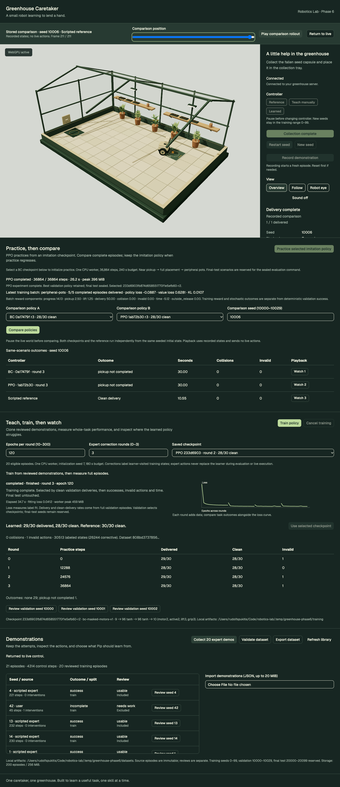
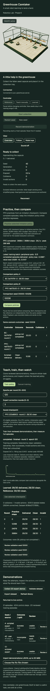

# Phase 6 — Reinforcement-learning practice and curriculum

Phase 6 is complete. A Gymnasium adapter and bounded PPO worker now practice the existing collection skill, preserve the imitation checkpoint, evaluate candidates on validation, and support same-seed browser comparisons. A frozen final-test evaluation is recorded below. Stop for user review before Phase 7; no LangGraph mission work has started.

## Review in the app

Run `pnpm setup:greenhouse` if dependencies need updating, then `pnpm dev:greenhouse` and open http://127.0.0.1:8086/.

- In **Practice, then compare**, compare the BC and PPO checkpoints on seed **10000** for delivery, or **10006** to inspect a learned pickup failure alongside a successful reference.
- **Compare policies** runs both selected policies and a fresh reference independently from the same initial state. The results show delivery/failure, time, collisions and rejected actions. **Watch 1/2/3** selects a recorded rollout; play, pause and scrub it in the main scene. Return to live restores the original live world without executing playback actions.
- In **Teach, train, then watch**, select a saved checkpoint and choose **Use selected checkpoint**, then start collection. BC and PPO remain explicitly labeled. A PPO round-0 checkpoint is its unmodified initialization, with zero practice steps.
- To practice, select a **BC** checkpoint, then **Practice selected imitation policy**. This starts one separate CPU worker with 36,864 steps and a 240-second budget. **Cancel training** uses the existing worker cancellation operation. The panel shows PPO steps, curriculum stage, training losses, reward components and validation-selected checkpoint.

Current validation-selected checkpoint: **`233d6903fb874d658551770f1e5efb60-r2`**. Its parent **`0a17479f7622474c97922b9b0c5bd9b4-r3`** remains available and unchanged. Local weights and full rollout states are ignored runtime artifacts; a fresh checkout needs Phase 5 data/training followed by Phase 6 practice. Python remains the application server; TypeScript 7, Base UI, R3F/Drei and WebGPU remain in place. Blender is not needed for this phase.

## What practice changed

The experiment ran three PPO initializations, seeds **7, 17 and 27**, each from the same Phase 5 actor, with **36,864 training steps** (110,592 total). Training uses scenario seeds 0–99 only. Validation uses all 30 seeds 10000–10029 after initialization and after each curriculum stage. Final-test data does not enter policy updates, reward design or checkpoint selection.

| Run | Worker seconds | Peak RSS MiB | Best practiced round / steps | Validation delivered | Clean | Invalid | Mean simulated seconds |
| --- | ---: | ---: | --- | ---: | ---: | ---: | ---: |
| BC parent | — | — | Phase 5 round 3 | 29/30 | 28/30 | 1 | 10.5200 |
| PPO seed 7 | 25.34 | 398.7 | round 1 / 12,288 | 29/30 | 28/30 | 1 | 10.5017 |
| PPO seed 17 | 26.32 | 395.7 | round 3 / 36,864 | 28/30 | 28/30 | 0 | 11.1650 |
| PPO seed 27, selected | 26.17 | 395.5 | round 2 / 24,576 | 29/30 | 28/30 | 1 | 10.4583 |
| Scripted reference | — | — | — | 30/30 | 30/30 | 0 | 10.5533 |

Selection uses clean deliveries, deliveries, fewer invalid actions, then shorter mean episode time. Ties retain the original parent. For seed 17 the job retains the BC parent rather than its weaker PPO candidates. The final comparison also includes that run's best actually practiced candidate, explicitly separated from the retained parent.

Practice did **not improve clean validation completion**. Several later checkpoints regress: seed 7's final round delivers 28/30, and seed 17 round 2 delivers 27/30 with 26 clean. The selected seed-27 checkpoint has the same success counts as BC, with a small time tie-break. This is not evidence of a meaningful speed improvement. Round-by-round results, including failures, are preserved in [experiment.json](experiment.json) and the `validation-<seed>-r<round>.json` files. Worker timings exclude interpreter/framework import and snapshot preparation; observed collection/update throughput is roughly 1,400 training steps per worker second including validation overhead, not a hardware-independent guarantee.

## Gymnasium environment and curriculum

`greenhouse.practice.environment.CaretakerEnv` wraps the existing `World`; it does not rewrite its physics, grasp gates, task completion or time limit. Phase 4 datasets and Phase 5 checkpoint configuration identities remain valid.

Observation space: float32 `Box` of nine normalized features in the unchanged Phase 5 order. Bounds are deliberately unbounded rather than clipping measured observations; Gymnasium's checker reports its advisory infinity-bound warnings. Action space is a `Dict` containing two `Box(-1,1)` motors, two `MultiBinary` active bits, and separate three-way `Discrete` lift/grip decisions. Actions outside the space are rejected. The decoder matches the Phase 5 actor.

Reset calls Gymnasium's seeded reset, then samples a scenario strictly from 0–99; the optional `scenario_seed` override also enforces that range. Gym's RNG seed and the dataset scenario seed are distinct. Reset clears reward milestones and task counters. Success/collision terminates; the unchanged 600-tick, 30-second time limit truncates. Stepping a finished world requires reset. GAE bootstraps the terminal observation at truncation, with no advantage carry across resets; true terminations do not bootstrap. This follows [Gymnasium's termination/truncation contract](https://gymnasium.farama.org/api/env/).

Each fixed-budget run spends one third of its steps in each stage:

1. **Near pickup:** the same seeded capsule, with the robot 0.65–0.95 m behind it, ±0.15 m lateral offset and ±0.25 rad heading variation.
2. **Full placement:** the unchanged base environment distribution across all 100 training scenarios. This broadens Phase 5's demonstration seed coverage of 0–19.
3. **Peripheral pots:** full placement with two existing pot colliders relocated to `(-0.35, 1.30)` and `(1.10, -1.25)` m in a private copy of the MuJoCo model. The shared compiled base model is never mutated.

All 300 stage/seed combinations were checked for clean reference completion. The small peripheral layouts retain clear routes: the nine-feature actor has no obstacle observations, so this curriculum makes **no obstacle-navigation claim**. Validation, final test, browser comparisons and live execution use the original world, without these curriculum overrides. Stage transitions are fixed by step budget, not an unimplemented competence gate.

## PPO initialization and objective

This is a small repository-owned [PPO-Clip implementation](https://spinningup.openai.com/en/latest/algorithms/ppo.html), not an assumed Stable-Baselines checkpoint conversion. Initialization explicitly loads and verifies the Phase 5 `9 → 96 tanh → 96 tanh → 10` actor state. Its deterministic decoder is unchanged, which makes the resulting actor checkpoints compatible with live inference. Initialization is evaluated before any PPO update and reproduces the BC validation outcomes.

During practice, stochastic actions use two Normal latent motors followed by tanh, two Bernoulli active decisions, and categorical lift/grip distributions. Initial motor log standard deviation is -3.5, constrained to [-5,-1]. The full joint sampled latent action is retained for probability ratios, including gated-off axes. Tanh Jacobians cancel between old/new log probabilities for the same samples. Entropy uses the latent distributions, so its motor term is not a transformed-action entropy estimate.

A separate randomly initialized `9 → 64 tanh → 64 tanh → 1` value network and exploration scale are training-only. No teacher labels, scripted correction actions, reference takeover or imitation loss are used in PPO updates. The actor alone is saved for deterministic execution; jobs are reproducible new runs, not resumable optimizer checkpoints.

| Setting | Value |
| --- | --- |
| Rollout / minibatch | 1,024 / 256 steps |
| PPO update epochs | up to 4 per rollout |
| Actor / value Adam learning rates | 0.00003 / 0.0003, epsilon 1e-5 |
| Discount / GAE lambda | 0.99 / 0.95 |
| Probability clip / target approximate KL | 0.2 / 0.015 |
| Value coefficient / latent entropy coefficient | 0.5 / 0.001 |
| Gradient norm clip | 0.5 |
| CPU threads | 1 |
| Default budget / request range | 240 seconds in UI; 10–600 seconds allowed |
| Step request range | 3,072–98,304, multiples of 3,072 |

KL stops further minibatches when it exceeds its threshold. Every update checks finite loss. Progress stores policy/value loss, latent entropy, approximate KL, clip fraction, stage, steps, completed episodes/deliveries and every reward component. Stored diagnostics describe the latest accepted minibatch, not an averaged full-batch objective.

## Reward ledger and exploitation checks

The base world's existing reward remains unchanged. PPO uses a separate versioned wrapper ledger, **`practice-ledger-v1`**, with each component logged independently:

| Component | Per-step contribution |
| --- | --- |
| Progress | Before/after target distance difference, clamped to ±0.05; zero at a holding-state transition |
| First pickup | +0.5 once per episode |
| First lift while holding to ≥0.265 m | +0.25 once per episode |
| Valid delivery | +10 at terminal success |
| Collision | -5 per newly counted collision |
| Invalid action | -0.1 per newly rejected action |
| Time | -0.005 per control step |
| Release outside tray | -1 per such release |

Milestone rewards cannot be collected repeatedly by dropping/regrasping. This shaping is not claimed to be policy-invariant or exploitation-proof: progress excludes target-switch discontinuities and can reward motion without delivery. We inspect full task success, failures, collisions, invalid actions and component totals rather than selecting by reward.

Across the three runs, the near stage completed 75–77/75–77 episodes successfully. Full placement completed 53/56, 57/59 and 62/62; peripheral pots completed 59/60, 59/60 and 58/59. Fixed stage budgets can discard one unfinished episode, and milestone rewards can precede its completion. No collision penalties or outside-release penalties were observed in these training logs. Rejected-action penalties persisted, and stronger training returns did not eliminate held-out failures. This bounded run does not establish absence of reward exploitation.

## Frozen final-test comparison

The selection manifest was created **before** opening seeds 20000–20099. It fixes the parent, one actually practiced validation-selected candidate per training seed, the global selected checkpoint, metadata/weights hashes, code identity and all 100 test seeds. The evaluator uses exclusive one-shot claim files and refuses changed source/weights or a second evaluation. Final-test scenarios remain blocked in training, browser comparison and ordinary learned activation.

| Frozen controller | Delivered | Clean | Collisions | Invalid actions | Mean episode seconds | Successful-only mean seconds |
| --- | ---: | ---: | ---: | ---: | ---: | ---: |
| Reference | 100/100 | 100/100 | 0 | 0 | 10.6055 | 10.6055 |
| BC parent | 93/100 | 92/100 | 0 | 917 | 11.2320 | 9.8194 |
| PPO seed 7, round 1 | 94/100 | 93/100 | 0 | 918 | 11.0205 | 9.8090 |
| PPO seed 17, round 3 | 93/100 | 93/100 | 0 | 51 | 11.2140 | 9.8000 |
| **Preselected PPO seed 27, round 2** | **93/100** | **92/100** | **0** | **2** | **11.1790** | **9.7624** |

The selected policy and BC fail the same seven scenarios: pickup on **20011, 20019, 20034, 20093, 20099**, delivery timeout on **20015 and 20090**. BC repeatedly requests invalid grasps on 20011/20019 (462/454 rejections); the selected PPO has only one rejection on 20011 and one on successful seed 20081. Those two difficult failures contribute most of BC's rejection count. Reduced rejected actions did not solve their pickup failures.

PPO successes across the three training seeds average **93.33/100**, with sample standard deviation **0.58**. All runs share one BC initialization; this is variability of fine-tuning, not independent end-to-end training. Wilson 95% success intervals are approximately 86.25–96.57% for 93/100 and 87.52–97.22% for 94/100. These overlapping intervals, small sample and paired scenarios do not establish PPO superiority. Seed 7's 94/100 was not used to replace the preselected seed-27 policy after viewing test results.

Measured final-test inference/simulation throughput is about 4,860–5,003 control steps/s for the learned actors and 6,238 for the reference on this machine. Timings include Python/MuJoCo and vary with load. Successful-only times exclude failures and must be read alongside completion rates; mean full-episode times include the timeouts.

### Reference-runner audit correction

The original final-test runner mistakenly reused one stateful `Reference` instance across all test episodes. It reported a spurious 1/100 reference result. The learned actors are stateless and their per-seed results were unaffected. The raw report is preserved as [final-test-original-invalid-reference.json](final-test-original-invalid-reference.json); **its reference row is invalid and must not be used**. The original runner is archived in [original-final-test-runner.py](original-final-test-runner.py).

A baseline-only correction verified the original seal/report, every frozen checkpoint and the original code identity allowing only the runner change. It then evaluated a fresh reference per seed, preserving learned results and checkpoint selection byte-for-byte. [final-test.json](final-test.json) is the corrected authoritative report and records original report/runner hashes and the correction reason. A regression test now requires 100 distinct reference instances, and the correction path is one-shot too. A later closure-binding/type annotation cleanup changes no policy or outcomes. No policy, reward, curriculum or hyperparameter changes were made after final-test inspection.

The final-test suite has now been inspected. It must not be described as untouched in subsequent phases; future tuning needs a newly reserved evaluation set or explicit disclosure that this suite is reused.

## Reproducibility and artifacts

With a compatible BC checkpoint and eligible local data, start the API and run:

```sh
node scripts/greenhouse-phase6/train.mjs
```

`GREENHOUSE_API_URL` overrides the default `http://127.0.0.1:8001`, and `GREENHOUSE_PARENT_CHECKPOINT` selects an explicit BC parent. The script runs seeds 7/17/27 sequentially, waits for worker exit, and reuses matching completed runs instead of accidentally repeating them. It writes job histories, all four checkpoint summaries per run and the experiment index. Time budget is 240 seconds per run, 720 seconds total maximum worker budget, plus startup/validation preparation. Actual measured worker time was 77.83 seconds total.

Final evaluation is an explicit offline command. Substitute your own completed PPO job IDs and a **new, genuinely uninspected test suite** for future experiments; the commands below document the original Phase 6 seed suite and refuse replacing an existing seal:

```sh
apps/greenhouse-server/.venv/bin/python -m greenhouse.practice.final_test seal \
  --training-dir apps/greenhouse-server/runtime/training/v1 \
  --seal apps/greenhouse-server/runtime/final-test/v1/selection.json \
  --jobs a95a6dceb4a7432e9f31b25a023fae54 1ab72b30ccbd4b45bc300bcb50c03330 233d6903fb874d658551770f1e5efb60

apps/greenhouse-server/.venv/bin/python -m greenhouse.practice.final_test evaluate \
  --training-dir apps/greenhouse-server/runtime/training/v1 \
  --seal apps/greenhouse-server/runtime/final-test/v1/selection.json
```

The suite is fixed in code: a future untouched suite requires a reviewed protocol/code change, not a different file path. The special `correct-reference` operation exists only for the audited baseline correction, requiring its preserved original runner/report and unchanged model sources. Ordinary fresh runs already create a fresh reference per episode and need no correction.

PPO jobs reuse Phase 5 start/status/cancel routes and storage bounds: one owned worker, 12 jobs, 512 MiB creation budget with a 32 MiB result reserve, 64 MiB input snapshot, 1 MiB inference weights and a two-policy cache. The API validates/freezes the BC parent and existing data; PPO does not fit on demonstration labels. Jobs additionally retain `parent.pt`, `parent.json`, `practice-config.json`, PPO histories, evaluations and actor checkpoints. Their lineage includes the parent hash, reward/config identity and number of practice steps. The inherited fitting-loss/sample metadata describes BC pretraining, not PPO optimization. Checksum/version/feature checks still apply to live loading.

`POST /api/v1/greenhouse/training/compare` accepts two distinct checkpoint IDs and one validation seed; it produces three recorded rollouts and a static scene template. A single comparison lock bounds concurrent work, which runs off the API event loop. Generated Pydantic JSON Schema → TypeScript/Ajv contracts cover requests and responses. No Node backend or OpenAPI frontend generator was added.

Training and browser tests ran against copied datasets/checkpoints in an isolated directory. The three completed PPO runs were then preserved in the normal local training store for user review. Binary models remain ignored; docs contain small JSON summaries, the complete final outcome tables, the audit evidence and screenshots.

## Verification

- `pnpm test:greenhouse`: 89 Python tests and 3 frontend tests, generated contract and asset checks, strict Python/TypeScript checks, lint and format checks.
- Gymnasium checks for all three stages, deterministic reset, invalid action/split guards, no shared model mutation, and 300 complete clean reference curriculum episodes.
- Hybrid likelihood/finite-gradient checks, actual PPO updates with reference calls disabled, timeout/termination GAE checks, real subprocess completion/cancellation and persisted candidate metadata.
- Final-test seal immutability/checksums, one-shot evaluation/correction and fresh reference instances; tests use synthetic final-test outcomes rather than consuming the real suite.
- All 15 production Chrome/WebGPU checks passed with no skips. Browser checks exercise exact comparison playback, seed/controller switching, pickup failure visibility, unchanged live state, no playback commands, no page errors and a 390 px viewport without horizontal overflow.
- Production Python/frontend build passes. Existing Three.js bundle-size and React plugin advisories remain.





The result is a measured PPO experiment, with fewer rejected actions for the selected actor but no completion gain over BC. Hardware transfer, image perception, autonomous obstacle avoidance and reliable multi-task missions remain unproved. Phase 7 is still unchecked.
