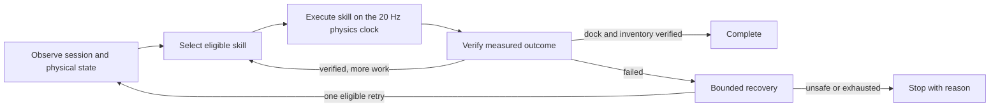
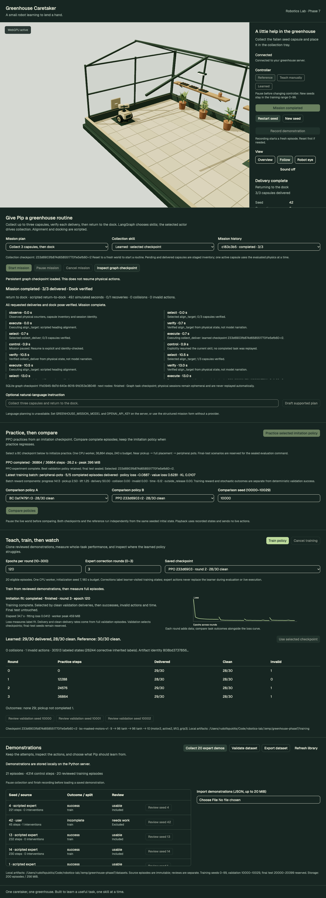
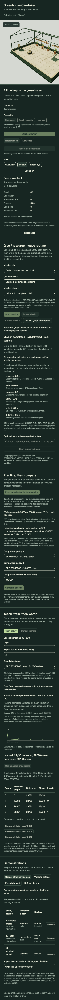

# Phase 7 — LangGraph greenhouse missions

Phase 7 adds persistent high-level routines over the existing collection skill: collect one to three capsules, verify each delivery, then return to the dock. The structured form works without a model provider. An optional LangChain tool call translates a natural-language instruction into a draft for review. Stop for user review before Phase 8.

## Try it

```sh
pnpm setup:greenhouse
pnpm dev:greenhouse
```

Open http://127.0.0.1:8086/. Reconnect if an older development session closed during the update.

1. Reset to a fresh ready seed. Default seed **42** has a verified three-capsule mission.
2. In the training panel, select **`233d6903fb874d658551770f1e5efb60-r2`**, the saved Phase 6 checkpoint. The mission form uses the selected checkpoint without changing its weights.
3. In **Give Pip a greenhouse routine**, keep **Collect 3 capsules, then dock** and **Learned · selected checkpoint**, then choose **Start mission**. There is also an explicitly labeled scripted collection comparison and a dock-only plan requiring no checkpoint.
4. Watch the actual robot, delivery count and current skill. **Pause mission**, **Resume mission**, and **Cancel mission** control physical execution. **Inspect graph checkpoint** reads SQLite task state without issuing commands.
5. Inspect the plan, executing implementation, recovery count and trace. Reset ends the old ownership generation; history remains inspectable and cannot command the new world.

The browser-verified learned mission completed **3/3 deliveries and docking in 49.1 simulated seconds**, with **zero collisions, invalid actions or recoveries**. It includes an explicit pause/resume and persistent graph inspection. The robot pose and velocity remain continuous between capsules. [Browser evidence](browser-mission.json) retains the full final mission and trace.

No Blender work is needed: the existing capsule asset and dock pad are reused. Docking means verified arrival and heading at the pad; electrical charging is not simulated.

## Measured limits

A small accelerated headless audit used the same selected actor and actual LangGraph/MuJoCo execution on training scenario seeds only:

| Starting seed | Delivered | Docked | Simulated seconds | Collisions | Invalid actions | Result |
| --- | ---: | --- | ---: | ---: | ---: | --- |
| 0 | 3/3 | yes | 47.60 | 0 | 0 | completed |
| 1 | 2/3 | no | 34.95 | 0 | 0 | no progress while holding the third capsule |
| 2 | 1/3 | no | 20.45 | 0 | 0 | no progress while holding the second capsule |
| 42 | 3/3 | yes | 49.10 | 0 | 0 | completed |

All four used zero recovery attempts. A no-progress failure while holding is deliberately not retried: restarting an empty-gripper collection skill would violate its precondition. The mission stops with the physical state intact rather than silently substituting the reference controller or resetting the robot.

[mission-benchmark.json](mission-benchmark.json) contains every trace, capsule outcome, final physical state, actor checksum and dependency versions. The four headless runs took about 0.69 wall seconds after setup on this machine; this accelerated audit is not the live 20 Hz browser experience or a performance guarantee. These are four training scenarios, not a generalization benchmark. No weights were trained or changed, and no Phase 6 final-test seeds were accessed again.

Multi-object execution extends the policy's usage beyond its single-object validation distribution. Adding orchestration does not solve the actor's remaining carrying/approach failures. The Phase 6 single-object results remain historical evidence, not a claimed mission success rate.

## Skill contracts and physical scope

The mission layer uses the unchanged `simulation.World` and its contact/grasp rules. It supplies a small inventory of capsules from the initial seed and the following training seeds modulo 100. One capsule at a time is materialized in the existing evaluated physics world; the others are staged visual inventory. Delivered capsules retain their measured release poses as visual inventory. They do not become additional simultaneous dynamic MuJoCo bodies. No multi-body capsule interaction claim is made.

At object changes, only capsule state is replaced; robot position, heading, velocity, wheel angles and lift remain continuous. Ordinary recording is disabled during missions so these extended routines cannot be mislabeled as Phase 4 single-object demonstrations. Mission time is monotonic across skill-local 600-tick clocks. Changing the active capsule ID makes the renderer snap the capsule transition rather than animate it flying from the tray to the next target.

| Skill | Implementation | Preconditions | Verified completion | Bounds |
| --- | --- | --- | --- | --- |
| `align_target` | Scripted heading controller | Empty gripper, active capsule, no collision | Target bearing ≤0.60 rad in magnitude; measured yaw speed ≤0.12 rad/s | 160 ticks |
| `collect_deliver` | Selected learned actor; optionally explicitly selected scripted reference | Empty gripper at pickup height; target aligned within 0.65 rad | World delivery flag, capsule physically inside tray, gripper empty | 600 ticks |
| `return_to_dock` | Scripted pose controller | All requested deliveries verified; empty gripper | Within 0.12 m of `(-2.55,-0.85)` m, heading within 0.15 rad of wall-facing π, speed ≤0.035 m/s, yaw speed ≤0.12 rad/s | 600 ticks |

Skill contracts are typed Pydantic models and exposed in the mission catalog. The selected actor's checksum is retained in the mission record. Scripted alignment is a visible precondition skill, including before the first pickup when needed. It is not included in the actor's earlier evaluation results. Docking and alignment never claim to be learned. Every collection gets a fresh reference state machine when the user explicitly chooses scripted collection.

## LangGraph workflow

The real `StateGraph` uses an `AsyncSqliteSaver`, with mission ID as `thread_id`. Its task state contains the typed request, selected skill, outcome, verified inventory and physical-state summary. The graph follows the [LangGraph checkpoint persistence model](https://docs.langchain.com/oss/python/langgraph/persistence):



The execute node waits for its motor skill's event while the existing authoritative session clock steps physics. Graph checkpoints are written at task boundaries, not every motor tick. No LLM chooses motor actions. The graph verifies world counters and poses rather than accepting a model's narration as completion.

Progress includes target distance or heading improvement, holding transitions and lift motion. A 120-tick window without progress fails the skill. The mission budget is 3,600 control ticks, or 180 simulated seconds. Recovery is limited to **one attempt per mission**, only for no-progress/skill-timeout failures with an empty gripper, no collisions and remaining budget. Recovery re-observes and reselects the eligible skill; it never teleports, overwrites the checkpoint or changes a learned run into scripted collection. Policy/physics errors, collisions and unsafe carrying failures stop immediately. Graph recursion is independently capped at 80 steps.

## Persistence and ownership

Default storage is `apps/greenhouse-server/runtime/missions/v1/`, relative to the server working directory. `GREENHOUSE_MISSION_DIR` selects another directory. Each `<id>.mission.json` stores plan, session/generation identity, actor checksum, inventory, verified counters, recovery budget, bounded trace and last physical-state summary. `graph.sqlite` stores real LangGraph task checkpoints. Files are written atomically off the event loop at boundaries/control operations and approximately once per second during active execution.

Pause freezes physical steps and preserves the current executing graph task. Resume is explicit, requires the same connected session and generation, and continues that task without replaying completed deliveries. Disconnect pauses. A WebSocket reattachment to the same existing session can resume after identity checks; the browser's **Reconnect** creates a replacement session, so old missions become read-only. Reset, session deletion, expiry and shutdown invalidate ownership and freeze the old physical summary before the world can change.

Physical sessions remain ephemeral, as established in earlier phases. API restart preserves mission records and graph checkpoints but marks unfinished missions **orphaned**. The app deliberately refuses to replay a persisted execute node into a new MuJoCo session. This phase provides durable task history and safe in-session pause/resume, not durable restoration of full MuJoCo integration state. A new mission gets a new identity and fresh ready world.

Limits are four active missions, one active mission per session, 32 stored missions, a 64 MiB creation-time storage check and 96 trace entries per mission. Existing session/training limits remain. Choose a new mission directory when its creation limit is reached; there is no automatic deletion of history. SQLite is suitable for this local single-server course project, not a multi-worker deployment. Persistence failures pause physical mission execution and expose the failure. Providers and storage failures do not authorize additional recovery.

## Optional language planning

Structured mission selection needs no API key. The language form explains when its provider is unavailable and remains disabled while the structured form works.

For optional language drafting, set these **server-side** environment variables before starting the API:

```sh
export GREENHOUSE_MISSION_MODEL='<tool-capable-model-id-supported-by-your-account>'
export OPENAI_API_KEY='<your-server-side-key>'
pnpm dev:greenhouse
```

This phase includes the LangChain OpenAI integration. The model identifier is explicit configuration; no model name, account access or price is assumed. Credentials are never sent to the browser. No real paid provider call was made during this implementation: provider behavior was tested with controlled LangChain message/model doubles. Live provider/account availability remains an optional integration check.

A draft makes one [LangChain bound-tool call](https://docs.langchain.com/oss/python/langchain/models) to `propose_greenhouse_mission`, with a typed `MissionIntent` schema. It supports collection of one to three capsules followed by docking, or dock-only with zero capsules. Watering, hardware actions, larger counts and other unavailable tasks are rejected rather than silently converted. The tool only validates a proposal; it has no session, checkpoint selection or motor access.

Drafts are shown for review and must be applied to the form and explicitly started. Tool name/count, schema and task/count consistency are validated again server-side. The request has a 12-second provider timeout inside a 15-second async deadline, zero SDK retries, one concurrent draft and at most 500 instruction characters. Provider errors are sanitized, timeout is explicit, and failed drafts never start a mission. The model is not called again during execution, verification or bounded recovery.

## API and contracts

All routes use `/api/v1/greenhouse`:

| Route | Behavior |
| --- | --- |
| `GET /missions` | Persisted/live missions, skill contracts and language availability |
| `POST /missions` | Start a typed plan in the current connected, fresh ready session/generation |
| `GET /missions/{id}` | Inspect current or archived mission state |
| `POST /missions/{id}/control` | Pause/resume/cancel with explicit current session/generation |
| `GET /missions/{id}/checkpoint` | Inspect SQLite checkpoint identity, next graph nodes and persisted task state |
| `POST /missions/draft` | Optional instruction → typed draft; never starts execution |

Capabilities now distinguish structured `missions: true` from dynamically configured `language_missions`. Session views and WebSocket snapshots include mission progress; scenes include staged extra capsule poses and aligning/docking stages. Normal manual/reference/learned sessions remain available. During a mission, conflicting manual/record/controller/start commands are rejected, while reset invalidates old ownership. A finished mission requires reset before ordinary control resumes.

The existing Pydantic JSON Schema → TypeScript/Ajv contract flow covers all additions; no Node backend or OpenAPI frontend generator was introduced. Python dependencies are locked locally: LangGraph 1.2.18, SQLite checkpointer 3.1.2, LangChain 1.4.7 and its OpenAI integration 1.7.3. Python 3.11 and TypeScript 7 remain unchanged. The base simulator, reference source and Phase 4 data format are unchanged.

## Reproduce the headless audit

From the repository root, with the documented saved actor available:

```sh
apps/greenhouse-server/.venv/bin/python -m greenhouse.missions.benchmark \
  --training-dir apps/greenhouse-server/runtime/training/v1 \
  --checkpoint 233d6903fb874d658551770f1e5efb60-r2 \
  --output docs/greenhouse-demo/phase7/mission-benchmark.json \
  --runtime-dir apps/greenhouse-server/runtime/mission-benchmarks/v1
```

Each audit has its own artifact namespace. No browser or provider is required. Full SQLite/runtime artifacts remain ignored; review JSON and screenshots are retained here. Browser checks used isolated dataset, training and mission directories, preserving the normal user library and checkpoints.

## Verification

- `pnpm test:greenhouse`: 96 Python tests, three frontend tests, generated contract checks, unchanged asset checks, strict Python/TypeScript and formatting/lint checks.
- `pnpm build:greenhouse`: Python distributions and production frontend pass; existing Three.js bundle-size/plugin advisories remain.
- Production Chrome/WebGPU checks cover 17 scenarios, including three learned deliveries/docking with pause/resume, graph checkpoint inspection, provider-free dock-only start, reconnect invalidation and mobile overflow checks. Two older connection assertions were scoped to the session status region after missions introduced their own accessible status; all six connection checks were rerun.
- Python mission tests cover continuous poses/no world reset between objects, full scripted three-object/dock completion, frozen pause, same-session reconnect/resume, stale/reset generation rejection, read-only restart checkpoints, explicit cancellation, duplicate starts, no hidden reference recovery and one bounded no-progress retry.
- Language doubles verify one tool call, typed plans, unsupported tasks, invalid tool responses, sanitized provider failures and timeout. No language calls occur in physical mission ticks.
- The real learned mission and BC/PPO comparison tests explicitly skip on fresh checkouts lacking compatible local checkpoints; the verified seeded run supplies them.





Phase 8 remains unchecked. No deployment or publishing was performed.
